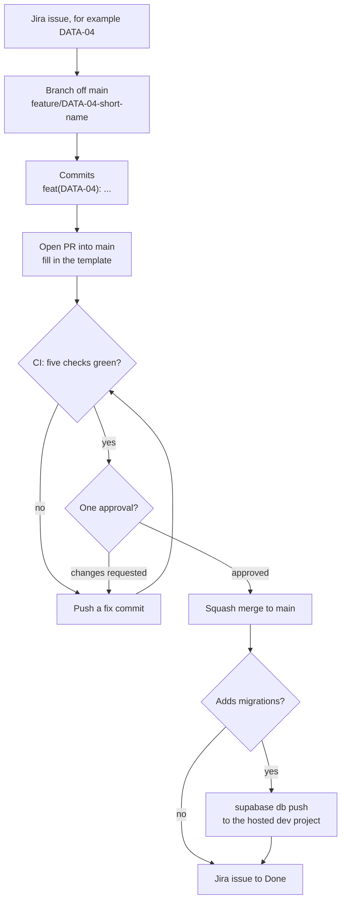

# Contributing to Sisig

## Branching Strategy

We follow **trunk-based development**: `main` is the only long-lived branch and is always releasable. Work lands through short-lived branches, each merged to `main` by pull request. The only other long-lived branches are `release/x.y` lines, and only when a hotfix is needed (see Release Strategy).

### Branch Naming

- Feature: `feature/JIRA-KEY-description`
- Bugfix: `fix/JIRA-KEY-description`
- Chore, config or docs: `chore/JIRA-KEY-description`
- Hotfix: `hotfix/JIRA-KEY-description`
- Release line (hotfix support only): `release/x.y`

Example: `feature/DATA-04-loyalty-schema-locations`

Some early branches did not follow this pattern (for example `feat/theme-01-tamagui-theme` and `fix/mobile-placeholder-assets`). New branches use it.

### Workflow

1. Create a short-lived branch off `main`
2. Make commits in [Conventional Commits](https://www.conventionalcommits.org/) format with the Jira key as the scope (see Commit Messages)
3. Open a PR into `main`. The PR title uses the same format as a commit, for example `feat(DATA-04): add loyalty ledger schema and slim locations`
4. Wait for CI. All five checks must pass (see Required Checks)
5. Get one approval from another developer; CODEOWNERS (`.github/CODEOWNERS`) routes review requests by area
6. Squash merge to `main`
7. If the PR adds migrations, apply them to the hosted dev project (see Database Changes)
8. Move the Jira issue to Done, and delete the branch (GitHub does not delete it automatically)



A change moves from a Jira issue to a merged squash commit on `main`. When the PR includes migrations, they reach the hosted Supabase project only after someone runs `supabase db push`, so the issue is not done until then.

### What the squash commit keeps

The repository's squash settings build the commit on `main` like this:

- **Title:** the PR title, or the commit's own title when the PR has a single commit. Either way it must carry the Jira key, and GitHub appends the PR number, as in `feat(DATA-04): add loyalty ledger schema and slim locations (#19)`.
- **Body:** the messages of every commit in the PR.
- **Not kept:** the PR description and review comments.

So write useful commit messages, and put rules and decisions into the docs or code comments, not only into the PR description. See [docs/README.md](docs/README.md#keeping-docs-current).

## Release Strategy

There are no releases yet: the repo has no tags, and release builds are not set up. The process below is the agreed plan.

### Standard Release

Normal releases are tags on `main`. Do not create a release branch for them.

1. Make sure `main` contains everything for the release and all checks are green
2. Open a PR with the version bump and changelog update (`chore(JIRA-KEY): release x.y.z`); it goes through the normal PR flow
3. Tag the merge commit on `main` as `vx.y.z`
4. Build and deploy by hand for now. No workflow in `.github/workflows` builds or deploys from tags, and release builds need EAS, which is not configured (no `eas.json`). A build and deploy pipeline is planned for DEVOPS-04.

### Hotfix

Use a `release/x.y` branch only to ship a hotfix to an already-released line.

1. If `release/x.y` does not exist yet, create it from the `vx.y.z` tag of the affected release
2. Create `hotfix/JIRA-KEY-description` off `release/x.y`
3. Open a PR into `release/x.y` with the fix; the same review and squash rules apply
4. After merge, tag the new patch version `vx.y.(z+1)` on `release/x.y` and deploy it by hand (no tag-based deploy workflow exists yet)
5. Bring the fix to `main` with its own PR (cherry-pick the squashed commit); never push to `main` directly

## Commit Messages

Follow [Conventional Commits](https://www.conventionalcommits.org/):

```
type(scope): description

[optional body]

[optional footer]
```

**Types:**

- `feat`: New feature
- `fix`: Bug fix
- `refactor`: Code refactor (no behavior change)
- `test`: Test additions/changes
- `docs`: Documentation
- `chore`: Build, dependency updates, config changes

**Scope is the Jira key** (for example `PLAT-01`, `DEVOPS-03`). Every commit and PR title must carry one so Jira can link the work. Area names (`mobile`, `admin`, `ui`, `api`, `supabase`) go in the body or PR description, not in place of the key. Some earlier PRs used an area scope, such as `fix(mobile): ...` in #15, #16 and #17; do not copy them. Nothing in CI checks the format, so reviewers do.

**Examples:**

- `feat(PLAT-01): scaffold pnpm workspaces with Turborepo`
- `fix(DEVOPS-02): generate database types for the public schema only`
- `test(PLAT-01): add Button component tests`

## Pull Request Process

1. Keep the PR title concise (under 70 characters), in Conventional Commits format with the Jira key
2. Fill out the PR template (`.github/pull_request_template.md`) completely: Jira key and link, changes, testing, screenshots in light and dark mode for UI changes, migration and RLS impact, analytics events, the accessibility checklist, the privacy inventory check and the REL-07 question
3. Request review from the CODEOWNER(s) for the changed areas; one approval from another developer is required
4. Address feedback in new commits (don't force-push)
5. Squash merge once CI is green and the PR is approved

## Code Quality

### Required Checks

These five CI jobs run on every PR into `main` and must all pass before merge:

| Check (job) | Workflow | What it runs |
|---|---|---|
| `lint-and-test` | `ci.yml` | `pnpm lint`, `pnpm typecheck`, `pnpm test`, `expo install --check`, package build, Android `expo export` |
| `database` | `ci.yml` | Local Supabase (migrations and seed), `pnpm db:test` (pgTAP), `pnpm db:lint` |
| `types-drift` | `ci.yml` | `pnpm db:types`; fails if `packages/api/src/database.types.ts` changes |
| `secrets` | `ci.yml` | gitleaks, plus greps for JWTs, service-role key references, Anthropic keys and Supabase secret keys (`sb_secret_`) in `apps/` and `packages/` |
| `deno-tests` | `edge-functions.yml` | `deno test`, `deno fmt --check`, `deno lint` on `supabase/functions` |

Branch protection does not enforce them yet (see Branch Protection), so check the PR's status before you merge. Details: [docs/DEVOPS-02-CI.md](docs/DEVOPS-02-CI.md).

`pnpm format:check` is not one of the checks (see [docs/DEVOPS-02-CI.md](docs/DEVOPS-02-CI.md#known-gaps)). It passes, so run `pnpm format` before you push to keep it that way.

### Running Locally

Run the `lint-and-test` steps before you push:

```bash
pnpm lint
pnpm typecheck
pnpm test
```

The database checks need Docker. If you do not have it, CI runs them for you. The full list of local commands for every job is in [docs/DEVOPS-02-CI.md](docs/DEVOPS-02-CI.md#running-ci-checks-locally).

## Mobile Development

The app runs in a development build (dev client), not Expo Go. Setup, the daily routine and troubleshooting are in [docs/LOCAL-DEVELOPMENT.md](docs/LOCAL-DEVELOPMENT.md).

Two rules that affect PRs:

- `expo run:android` generates `apps/mobile/android/` and adds `android` and `ios` scripts to `apps/mobile/package.json`. The folders are git-ignored. The `package.json` change is not: do not commit it.
- Keep test files out of `apps/mobile/app/`. Expo Router turns every file there into a route, and a test bundled as a screen crashes the app.

## Data Layer

The shared data layer lives in `packages/api` (`@sisig/api`). The mobile wiring is in `apps/mobile/src/lib`. [docs/ARCHITECTURE.md](docs/ARCHITECTURE.md) explains the design. The rules reviewers check:

- **Config:** `apps/mobile/.env.local` sets `EXPO_PUBLIC_SUPABASE_URL` and `EXPO_PUBLIC_SUPABASE_ANON_KEY` (the publishable key). Never commit it. Expo inlines `EXPO_PUBLIC_*` values into the bundle, so only public values may use that prefix. A service-role key must never reach the app; CI scans for it.
- **Client:** create Supabase clients only with `createSupabaseClient` (`@sisig/api`). The app's single client is `apps/mobile/src/lib/supabase.ts`.
- **Sessions:** stored only through `nativeSessionStorage` (AES-256-GCM, key in SecureStore). Never write tokens to AsyncStorage directly.
- **Logout:** `signOutAndPurge` (`apps/mobile/src/lib/logout.ts`) clears every per-user store. Add any new per-user store to it.
- **Query keys:** add every key to the `keys` factory in `packages/api/src/query-keys.ts`. Never inline key arrays.
- **Queries:** expose each query as `xxxQueryOptions(client)` plus a thin `useXxx` wrapper, as `useMenuCategories` does in `packages/api/src/hooks/useMenu.ts`. Use `createQueryClient()` for the app's QueryClient.
- **Errors:** throw `normalizeError(error)` from queries and mutations, and show users only `error.message` from the `AppError` it returns.
- **Writes:** points, redemptions and orders change only through RPCs or Edge Functions, never by direct table writes. `useCreateOrder` in `packages/api/src/mutations.ts` predates this rule; do not copy its pattern.
- **Offline cache:** only keys on the `persistedQueryKeyPrefixes` allowlist (`packages/api/src/query-keys.ts`) are written to disk. Add a key only if its data is not personal. Mutations are never persisted.

## Database Changes

Every schema change is a migration in `supabase/migrations/`, made with `pnpm db:new <name>` and merged through a normal PR. The rules for writing migrations are in [supabase/CONVENTIONS.md](supabase/CONVENTIONS.md).

1. **In the PR:** add the migration, pgTAP tests in `supabase/tests/database/` for what it changes, and the regenerated `packages/api/src/database.types.ts` (`pnpm db:types`, which needs the local stack and Docker). Fill in the template's Migration Impact section. CI's `database` and `types-drift` jobs apply every migration to a fresh local database and fail on test, lint or type differences.
2. **Destructive migrations** (dropping a table or column, deleting or rewriting rows): before merge, audit the data in the hosted dev project (for example, row counts for every affected table), back it up, and record the result in the PR. `supabase/migrations/20261106230037_retire_legacy_loyalty_tables.sql` (DATA-04) is an example.
3. **After merge:** CI does not deploy migrations. Someone with access to the hosted dev project runs `supabase db push` from an up-to-date `main` (preview first with `--dry-run`). Until then the hosted database is behind `main`.

The full procedure (login, link, dry run, push, backups) is in [docs/SUPABASE.md](docs/SUPABASE.md).

## TypeScript Strict Mode

Every TypeScript workspace extends `packages/config/tsconfig.json`, which sets `strict: true`. No `any` types: use proper typing.

## Branch Protection

These are GitHub repository settings, not files in this repo. **None of them is configured yet:** as of 2026-11-06, `gh api repos/Alexd2004/Sisig/branches/main/protection` returns 404 "Branch not protected", and the repo has no rulesets. Until a repo admin sets them, these rules are team discipline, not enforcement.

The intended settings, under Settings > Branches for `main` (and for `release/*` lines once they exist):

- PR required for all changes
- At least one approval from another developer; `.github/CODEOWNERS` routes review requests by area
- The five required checks above must pass (see [docs/DEVOPS-02-CI.md](docs/DEVOPS-02-CI.md#required-status-checks-manual-github-setting))
- No direct pushes
- No force pushes

Squash-only merging is a separate setting under Settings > General > Pull Requests. Today merge commits and rebase merging are still allowed there, so pick **Squash and merge** by hand. "Automatically delete head branches" is off, so delete your branch after merge.

## Onboarding

New developers should:

1. Follow [docs/LOCAL-DEVELOPMENT.md](docs/LOCAL-DEVELOPMENT.md) to set up a Mac and run the app on an Android emulator
2. Read this file
3. Skim [docs/README.md](docs/README.md) for the other guides, and read the ones for your area

## Questions?

Start at [docs/README.md](docs/README.md), which lists every guide. `apps/admin` has no README yet; it is planned with ADM-01.
