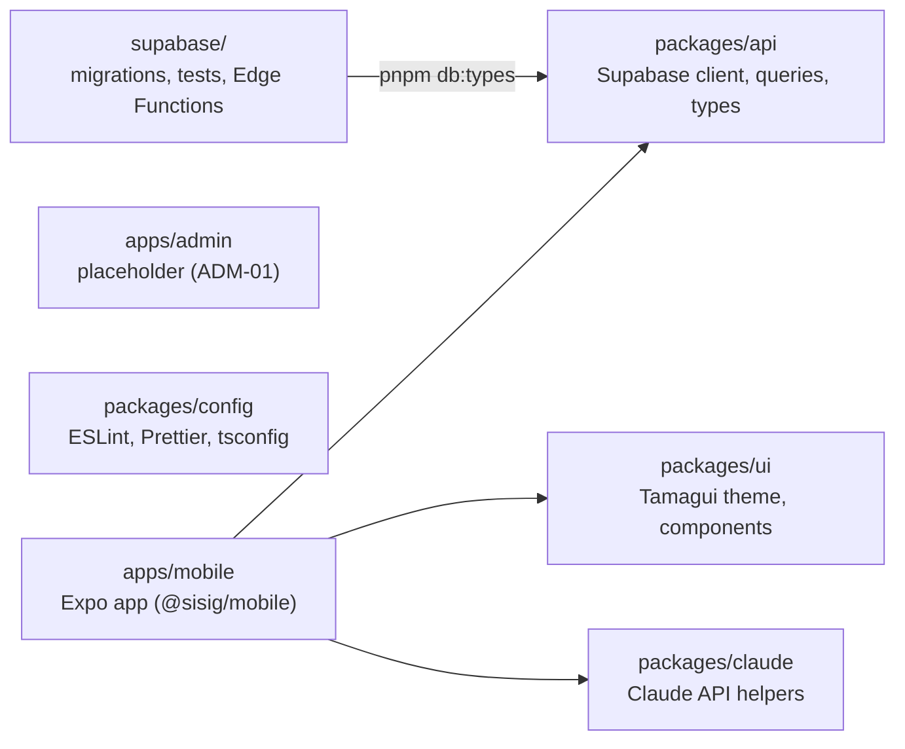

# Sisig Platform

> Monorepo for the Sisig Eh! rewards app: a React Native (Expo SDK 51) mobile app, shared TypeScript packages, and a Supabase backend. pnpm workspaces, Turborepo, TypeScript strict mode.

## Quick Start

You need a Mac with Node.js 18 or later, pnpm 9, JDK 17, the Android SDK and an Android emulator, plus an `apps/mobile/.env.local` file with the hosted Supabase URL and publishable key. [docs/LOCAL-DEVELOPMENT.md](docs/LOCAL-DEVELOPMENT.md) walks through all of it, step by step.

With those in place, the first run is:

```bash
git clone https://github.com/Alexd2004/Sisig.git
cd Sisig
pnpm install
```

```bash
pnpm turbo run build --filter='@sisig/mobile^...'
```

```bash
pnpm -F @sisig/mobile exec expo run:android
```

The first block clones the repo and installs dependencies. The second builds the workspace packages, which the app imports from their `dist/` folders. The third builds the development client, installs it on the running emulator, and starts Metro. After that, the daily command is:

```bash
pnpm -F @sisig/mobile exec expo start --dev-client --android
```

Expo Go cannot run this app. iOS is not set up yet (it needs the full Xcode app).

## Documentation

[docs/README.md](docs/README.md) lists every doc, what it covers and who it is for, and explains the PDF versions in `docs/pdf/`. The ones most people need:

- [docs/LOCAL-DEVELOPMENT.md](docs/LOCAL-DEVELOPMENT.md): set up a Mac and run the app.
- [CONTRIBUTING.md](CONTRIBUTING.md): branches, commits, pull requests, database changes.
- [docs/ARCHITECTURE.md](docs/ARCHITECTURE.md): how the system fits together.
- [docs/SUPABASE.md](docs/SUPABASE.md): the hosted Supabase project and applying migrations.
- [docs/DEVOPS-02-CI.md](docs/DEVOPS-02-CI.md): the CI checks.

## Repo Map



Arrows from the app are runtime imports; the app loads each package from its built `dist/` folder. `pnpm db:types` generates `packages/api/src/database.types.ts` from a local database built from the migrations. `packages/config` holds the lint, format and TypeScript config every workspace extends.

```
Sisig/
├── apps/
│   ├── mobile/          # Expo app: app/ (Expo Router routes), src/ (components, lib, session, navigation)
│   └── admin/           # Placeholder scripts only; framework chosen in ADM-01
├── packages/
│   ├── api/             # @sisig/api: Supabase client, query keys and hooks, generated database types
│   ├── ui/              # @sisig/ui: Tamagui theme, brand tokens, Button, Text, TextInput
│   ├── claude/          # @sisig/claude: Claude API client and helpers
│   └── config/          # @sisig/config: shared ESLint, Prettier and TypeScript config
├── supabase/            # config.toml, migrations/, tests/database/ (pgTAP), functions/ (Edge Functions), seed.sql
├── docs/                # Developer guides (index: docs/README.md)
├── .github/             # CI workflows, CODEOWNERS, PR template
├── package.json         # Root scripts and pnpm workspaces
├── turbo.json           # Turborepo task pipeline and cache outputs
└── CONTRIBUTING.md      # Branching, commits, pull requests, releases
```

## Key Commands

Run these from the repo root.

| Command | What it does |
|---|---|
| `pnpm install` | Install dependencies for every workspace |
| `pnpm turbo run build --filter='@sisig/mobile^...'` | Build the packages the mobile app depends on (into `dist/`) |
| `pnpm -F @sisig/mobile exec expo run:android` | Build and install the Android dev client, then start Metro |
| `pnpm -F @sisig/mobile exec expo start --dev-client --android` | Start Metro and open the installed dev client |
| `pnpm lint` | ESLint in every workspace |
| `pnpm typecheck` | `tsc --noEmit` in every workspace (builds dependencies first) |
| `pnpm test` | Jest in every workspace |
| `pnpm format` | Prettier, writing changes |
| `pnpm format:check` | Prettier check without changes (not run in CI) |
| `pnpm -F @sisig/mobile run doctor` | Run `expo-doctor` on the mobile app |
| `pnpm db:start`, `pnpm db:reset`, `pnpm db:test`, `pnpm db:lint`, `pnpm db:types`, `pnpm db:new <name>` | Local Supabase commands (need Docker); see [supabase/README.md](supabase/README.md) |
| `pnpm build` | Build every workspace that has a `build` script: `tsc` for the shared packages, a placeholder for the admin app. The mobile app has none (see Notes) |
| `pnpm docs:pdf` | Regenerate the PDFs in `docs/pdf/`; see [docs/README.md](docs/README.md) |

Notes:

- The mobile app has no `build` script, so `pnpm build` skips it. CI checks the JS bundle with `expo export`. Release builds need EAS, which is not set up (DEVOPS-04).
- Prettier reads the shared config in `packages/config/prettier.config.js` through the root `prettier.config.js`. `packages/api/src/database.types.ts` is generated and listed in `.prettierignore`, so `pnpm format` leaves it alone.
- Plain `pnpm doctor` runs pnpm's own checker, not `expo-doctor`, because `doctor` is a built-in pnpm command. Use `run doctor` as shown.
- `pnpm test --watch` does not work at the root: pnpm rejects `--watch`. Pass it to Jest in one package: `pnpm -F @sisig/mobile test -- --watch`.

## Development Client

The app runs in its own development build, made with `expo-dev-client` (listed under `plugins` in `apps/mobile/app.json`). This is the team's chosen workflow; Expo Go is not supported. Some native packages are declared in `apps/mobile/package.json` (`@sentry/react-native`, `lottie-react-native`, `react-native-gesture-handler`, `expo-device`) but no code imports them yet.

- Build and install it with `expo run:android`. Rebuild it only when native code changes: a dependency with native code, or `apps/mobile/app.json`.
- `expo run:android` generates `apps/mobile/android/` and adds `android` and `ios` scripts to `apps/mobile/package.json`. The `android/` and `ios/` folders are git-ignored. The `package.json` change is not: do not commit it.
- `pnpm -F @sisig/mobile exec expo run:ios` needs the full Xcode app and is not set up on the team's Mac.

Details and troubleshooting: [docs/LOCAL-DEVELOPMENT.md](docs/LOCAL-DEVELOPMENT.md).

## TypeScript Strict Mode

Every TypeScript workspace extends `packages/config/tsconfig.json`, which sets `strict`, `noImplicitAny`, `strictNullChecks`, `noUnusedLocals`, `noUnusedParameters`, `noImplicitReturns` and related flags. `pnpm typecheck` must pass with zero errors. `apps/admin` has placeholder scripts only, so it has no TypeScript yet.

## Testing

Jest runs in each workspace, with React Native Testing Library for components. Examples:

- `packages/ui/src/Button.test.tsx`: component test
- `packages/ui/src/theme/contrast.test.ts`: WCAG AA contrast for every semantic colour pair
- `packages/api/src/hooks/useMenu.test.ts`: query options test
- `apps/mobile/src/navigation/index-redirect.test.tsx`: screen test for `app/index.tsx`

Keep test files out of `apps/mobile/app/`. Expo Router turns every file in that folder into a route, so a test there is bundled as a screen and crashes the app at launch (fixed in PR #18).

Database tests (pgTAP) live in `supabase/tests/database/` and run with `pnpm db:test`, which needs Docker. CI runs them on every PR.

## Theme and Brand Tokens (THEME-01)

- **Brand values** live in one file: `packages/ui/src/theme/brand.ts`. Components never use raw hex colours. They use semantic names through `@sisig/ui` (`useAppColors`, `useThemedStyles`, `Text`, `TextInput`). `apps/mobile/src/no-raw-colors.test.ts` and `packages/ui/src/no-raw-colors.test.ts` fail if a component contains a hex literal.
- **Light and dark** follow the OS setting (`userInterfaceStyle: "automatic"` in `apps/mobile/app.json`). There is no in-app override in v1.
- **Font scaling** is capped at `FONT_SCALE_CAP` (1.5x) in `Text` and `TextInput`.
- **Contrast:** `packages/ui/src/theme/contrast.test.ts` checks WCAG AA (4.5:1) for every foreground/background pair in both themes. It runs under `pnpm test` in CI.
- **Rebrand:** edit `brand.ts`, then run `pnpm test`. The contrast test catches any pair that falls below AA. See [docs/ARCHITECTURE.md](docs/ARCHITECTURE.md) ("Rebrand in 10 Minutes").

### Pending client assets

The values below are placeholders until the client supplies final assets. Do not treat them as brand decisions.

| Asset | Current placeholder | Where to change |
|---|---|---|
| Brand colour palette (light and dark) | Placeholder palette tuned to pass WCAG AA. It is not the brand palette. | `packages/ui/src/theme/brand.ts` (`palette`, `lightTheme`, `darkTheme`) |
| Brand fonts (body and heading) | Inter from Google Fonts via `@expo-google-fonts/inter` (Regular 400 and SemiBold 600). Package metadata lists `MIT AND OFL-1.1`. Confirm the licence before any release. | `brandFonts` in `brand.ts`; the `expo-font` plugin entry in `apps/mobile/app.json`; the imports in `apps/mobile/app/_layout.tsx` |
| Licensed font files and final brand fonts | Not yet received from the client | Client input. Replace the placeholder fonts when they arrive. |
| App icon, adaptive icon, splash and favicon | Solid placeholder images (PR #17). Final artwork comes with DSGN-01. | `apps/mobile/assets/` |

## Continuous Integration (DEVOPS-02)

Every pull request into `main`, and every push to `main`, runs two workflows in `.github/workflows/`:

| Check (job) | What it runs |
|---|---|
| `lint-and-test` | ESLint, `tsc --noEmit`, Jest, `expo install --check`, package build, Android `expo export` bundle |
| `database` | Local Supabase start (migrations and seed), pgTAP tests, `supabase db lint` |
| `types-drift` | `pnpm db:types`; fails if `packages/api/src/database.types.ts` changes |
| `secrets` | gitleaks, plus greps for JWTs, service-role key references, Anthropic keys and Supabase secret keys (`sb_secret_`) in `apps/` and `packages/` |
| `deno-tests` | Edge Function tests, `deno fmt --check`, `deno lint` |

Branch protection on `main` is not configured yet, so GitHub does not block a merge when a check fails. The team rule is to merge only when all five pass. Job details, local commands and fixes for common failures are in [docs/DEVOPS-02-CI.md](docs/DEVOPS-02-CI.md).

## Branching and Code Review

See [CONTRIBUTING.md](CONTRIBUTING.md) for trunk-based development, branch names, Conventional Commits with the Jira key as scope, the PR process, database changes and releases.

`.github/CODEOWNERS` routes review requests by area. Every area currently points at @Alexd2004, because the DEV-A, DEV-B and DEV-C team handles do not exist yet. Any developer may approve a PR.

## Known Issues

Checked on 2026-11-06:

- **`pnpm format:check` is not run in CI.** It passes locally. See [docs/DEVOPS-02-CI.md](docs/DEVOPS-02-CI.md#known-gaps).
- **`expo-doctor` fails three checks** on a clean clone (`pnpm -F @sisig/mobile run doctor`):
  - `app.json`: `ios.supportsTabletMode` is not an allowed property.
  - `@types/react-native` is installed directly, but `react-native` ships its own types.
  - Missing peer dependency `expo-application`, required by `sentry-expo`.
- **Prebuild edits `apps/mobile/package.json`.** It adds `android` and `ios` scripts, which show up in `git status`. Undo them with `git restore apps/mobile/package.json`. The generated `apps/mobile/android/` and `apps/mobile/ios/` folders are git-ignored.
- **iOS is not verified.** The Android dev client was built and run on an emulator on 2026-11-06. `expo run:ios` has not been run, because the team's Mac has no full Xcode.
- **Branch protection is not configured** on `main` (see [CONTRIBUTING.md](CONTRIBUTING.md#branch-protection)).

## Troubleshooting

Setup and runtime problems (Metro cannot resolve a package, old bundle, emulator offline, Java, disk space) are covered in [docs/LOCAL-DEVELOPMENT.md](docs/LOCAL-DEVELOPMENT.md#troubleshooting). CI failures are covered in [docs/DEVOPS-02-CI.md](docs/DEVOPS-02-CI.md#common-failures--fixes).

## Further Reading

- [Expo Router documentation](https://docs.expo.dev/router/introduction/)
- [Expo development builds](https://docs.expo.dev/develop/development-builds/introduction/)
- [Turborepo task caching](https://turbo.build/repo/docs/core-concepts/caching)
- [pnpm workspaces](https://pnpm.io/workspaces)
- [React Native Testing Library](https://testing-library.com/docs/react-native-testing-library/intro)
- [Supabase CLI](https://supabase.com/docs/guides/cli)
