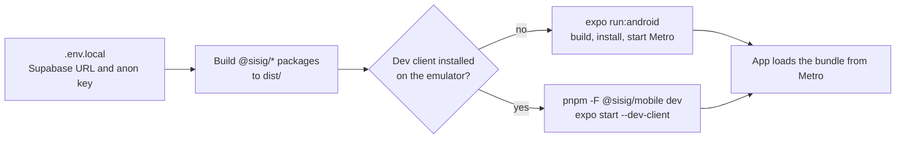

# Sisig Mobile App

The Sisig Eh! customer app. It uses Expo SDK 51 (React Native 0.74, React 18.2), Expo Router 3 for file-based routing, Tamagui themes through `@sisig/ui`, Supabase through `@sisig/api`, and TypeScript strict mode.

The app runs as a **development build** (a "dev client": a debug build of the app that loads JavaScript from Metro, the React Native bundler). **Expo Go is not supported.**

For how the pieces fit together, with diagrams, see [docs/ARCHITECTURE.md](../../docs/ARCHITECTURE.md).

## Quick Start

The team runs the app on an Android emulator (AVD `Sisig_Pixel_API_34`, API 34) against the hosted Supabase dev project. The full setup, including Android Studio and the emulator, is in [docs/LOCAL-DEVELOPMENT.md](../../docs/LOCAL-DEVELOPMENT.md). In short, from the repository root:

```bash
pnpm install

# 1. Create apps/mobile/.env.local (see "Environment Variables")

# 2. Build the shared packages. Metro reads them from their dist/ folders.
pnpm turbo run build --filter='@sisig/mobile^...'

# 3. First run: build and install the dev client, then start Metro
pnpm -F @sisig/mobile exec expo run:android

# Later runs: start Metro for the installed dev client
pnpm -F @sisig/mobile dev
```



Run the package build again after you change code under `packages/*/src` or pull changes to it. After you pull new dependencies, restart Metro with `--clear`.

## Development Client

The `dev` script is `expo start --dev-client`, so Metro serves a development build, not Expo Go. `app.json` lists config plugins (`expo-router`, `expo-secure-store`, `expo-dev-client`, `expo-font`) and are applied when the native project is built. `app.json` also sets `newArchEnabled: true` under `ios` and `android`, but those keys have no effect on SDK 51: the generated `android/gradle.properties` has `newArchEnabled=false`. Turning the new architecture on in SDK 51 would need the `expo-build-properties` plugin.

### Android

```bash
pnpm -F @sisig/mobile exec expo run:android
```

This generates `apps/mobile/android`, builds a debug app, installs it on the running emulator or a connected device, and starts Metro. See [docs/LOCAL-DEVELOPMENT.md](../../docs/LOCAL-DEVELOPMENT.md) for the emulator setup.

### iOS

Not set up yet. It needs a full Xcode install. Once Xcode is installed, the command is:

```bash
pnpm -F @sisig/mobile exec expo run:ios
```

### Generated native folders

`expo run:android` and `expo run:ios` generate `apps/mobile/android` and `apps/mobile/ios`. They are local build output. Do not commit them.

### When to rebuild the dev client

Rebuild with `expo run:android` after you add or upgrade a package with native code, or change native config in `app.json` (plugins, icons, bundle identifiers). JavaScript and TypeScript changes only need Metro to reload.

### Release builds

Not configured. The `build` script runs `expo build`, which the local Expo CLI rejects, and there is no `eas.json`. Store builds through EAS are planned (DEVOPS-04).

## Environment Variables

Create `apps/mobile/.env.local`. The root `.gitignore` ignores `.env.local`, so it is never committed.

```bash
EXPO_PUBLIC_SUPABASE_URL=https://<project-ref>.supabase.co
EXPO_PUBLIC_SUPABASE_ANON_KEY=<publishable anon key>
```

- Expo reads the file when Metro starts and inlines every `EXPO_PUBLIC_*` value into the JavaScript bundle. Anyone with the app can read these values, so only public values may use the prefix. The anon key is Supabase's publishable key. Never put a service-role key or any other secret here; CI scans client code for them.
- `src/lib/supabase.ts` throws at launch if either variable is missing: `EXPO_PUBLIC_SUPABASE_URL and EXPO_PUBLIC_SUPABASE_ANON_KEY must be set.`
- After you change the file, restart Metro. Add `--clear` if the old value still shows.
- `src/types/process-env.d.ts` declares the only two variables app code may read. A new variable must be added there too.

## Project Structure

```
apps/mobile/
├── app/                        # Expo Router routes. Every file here is a route.
│   ├── _layout.tsx             # Providers and RootNavigator (splash, redirects, modals)
│   ├── index.tsx               # Redirects to /home
│   ├── (tabs)/                 # Bottom tabs: home, order, rewards, code, more
│   │   ├── _layout.tsx         #   Tabs, pop-to-root on active tab press
│   │   └── <tab>/              #   _layout.tsx (Stack) and index.tsx per tab
│   ├── (auth)/                 # welcome, login, sign-up, verify-email, reset-password
│   ├── redeem-confirm.tsx      # Modal (placeholder)
│   ├── item/[id].tsx           # Modal (placeholder)
│   └── ai-*.tsx                # ai-chat, ai-journal, ai-summarizer, ai-translator (UI only)
├── src/
│   ├── components/             # AppThemeProvider, SignInRequired, PlaceholderScreen, TabBarIcon,
│   │                           # ForcedUpdateScreen, UpdateBanner, AnnouncementBanner, OrderingPausedCard
│   ├── config/                 # Remote config (PLAT-06): provider, useFeature, update gate, caches, reporter
│   ├── hooks/                  # useAI, useImageAnalysis (not used by any screen)
│   ├── lib/                    # supabase, session-storage, session-lifecycle, logout, query-persistence
│   ├── navigation/             # auth-gate, pop-to-root, stack-options
│   ├── session/                # SessionProvider, useSession, Supabase session source
│   ├── types/process-env.d.ts  # The EXPO_PUBLIC_* variables app code may read
│   └── no-raw-colors.test.ts   # Fails on hex colours in app/ or src/
├── assets/                     # Placeholder icon, adaptive icon, splash, favicon
├── app.json                    # Expo config: plugins, scheme "sisig", package ids
├── babel.config.js             # babel-preset-expo
├── jest.config.js              # jest-expo preset
└── tsconfig.json               # Extends @sisig/config/tsconfig
```

Tests sit next to the code they cover under `src/`. There is no `metro.config.js`; Expo's default Metro config handles the monorepo.

## Routing

Files under `app/` become routes. Folders in parentheses are route groups and do not appear in the URL.

| Route | File | Who can see it |
|-------|------|----------------|
| `/` | `app/index.tsx` | Redirects to `/home` |
| `/home`, `/order`, `/more` | `app/(tabs)/<tab>/index.tsx` | Everyone |
| `/rewards`, `/code` | `app/(tabs)/<tab>/index.tsx` | Signed-in users. Guests see a sign-in prompt from `SignInRequired`. |
| `/welcome`, `/login`, `/sign-up`, `/verify-email`, `/reset-password` | `app/(auth)/*.tsx` | Everyone. A signed-in user is redirected out to `returnTo` or `/home`. |
| `/redeem-confirm`, `/item/[id]` | `app/redeem-confirm.tsx`, `app/item/[id].tsx` | Modals |
| `/ai-chat`, `/ai-journal`, `/ai-summarizer`, `/ai-translator` | `app/ai-*.tsx` | No screen links to them |

The auth screens are placeholders until AUTH-01 to AUTH-03, so nobody can sign in from the app yet. When the session changes from signed in to signed out, the app clears every stack and opens `/welcome`.

**Keep test files out of `app/`.** Expo Router bundles them as routes, and the app crashes on the device with "Property 'jest' doesn't exist". PR #18 moved the index test to `src/navigation/index-redirect.test.tsx`, which imports `../../app/index`.

## Session and Data Layer

Details and diagrams are in [docs/ARCHITECTURE.md](../../docs/ARCHITECTURE.md#plat-03-session-and-data-layer).

- **Supabase client.** `src/lib/supabase.ts` creates the only Supabase client and the QueryClient with `createSupabaseClient` and `createQueryClient` from `@sisig/api`. `attachSessionLifecycle` runs token auto-refresh only while the app is in the foreground.
- **Session storage.** `src/lib/session-storage.ts` encrypts the session with AES-256-GCM. The key is in the device keystore (`expo-secure-store`) and the ciphertext is in AsyncStorage. Never write tokens to AsyncStorage directly.
- **Session status.** `SessionProvider` (`src/session/session.tsx`) gives `useSession()`: `status` (`loading`, `signed-in`, `signed-out`) and `signOut()`. `createSupabaseSessionSource` (`src/session/supabase-source.ts`) restores the session with `getSession`, maps `onAuthStateChange` events to a status, and purges the device on every `SIGNED_OUT`.
- **Sign-out.** `signOutAndPurge` (`src/lib/logout.ts`) signs out locally, then clears the in-memory query cache, the encrypted session entries and key, and the persisted query cache. Add any new per-user store to this function.
- **Query cache on disk.** `src/lib/query-persistence.ts` persists only successful menu and rewards-catalogue queries, for 24 hours. Points, profile, orders and auth are never written to disk.
- **Data hooks.** Query keys, hooks, mutations and `normalizeError` live in `packages/api`. No screen uses the hooks yet; the screens show sample data.

## Remote Config, Kill Switches and Forced Update

Details and a diagram are in [docs/ARCHITECTURE.md](../../docs/ARCHITECTURE.md#plat-06-remote-config-and-forced-update). To change values, follow [docs/runbooks/remote-config.md](../../docs/runbooks/remote-config.md).

- **`RemoteConfigProvider`** (`src/config/remote-config.tsx`, mounted in `app/_layout.tsx`) reads `public.app_config` on launch, every 5 minutes and on every return to the foreground. It keeps the last good rows in AsyncStorage (`sisig.app-config`), so an offline launch uses them, and falls back to the bundled defaults on a first offline launch.
- **Gate a feature** with `useFeature('ordering')` or `useFeature('receiptScan')` (`src/config/useFeature.ts`). It returns `{ enabled, message }`. The Order tab hides its menu and checkout while ordering is off and shows `OrderingPausedCard` with the message.
- **Update gate.** Below `min_supported_version_<platform>`, the root layout shows `ForcedUpdateScreen` instead of the navigator. Below `recommended_version`, `UpdateBanner` appears on Home at most once a day. Neither ever triggers from the bundled defaults or a failed fetch.
- **Installed version.** `getInstalledVersion()` (`src/config/installed-version.ts`) reads `Constants.expoConfig.version` (the `version` in `app.json`), because `expo-application` is not installed and adding it needs a dev client rebuild. Bump `version` in `app.json` for every store release, or the gate compares the wrong number.
- **Reporting.** Malformed or unknown config values go to `reportConfigIssue` (`src/config/reporter.ts`): `console.warn` in development, nothing in release builds. PLAT-04 plugs Sentry in with `setConfigReporter`.
- **Testing a screen that reads the config.** Without a provider, `useRemoteConfig()` returns the bundled defaults. To test other values, wrap the screen in `RemoteConfigProvider` with a fake client, cache and `AppState`, as `src/config/remote-config.test.tsx` does.

## Theme and UI Components

- Use `Text`, `TextInput` and `Button` from `@sisig/ui`, not the React Native components. `Text` and `TextInput` cap OS font scaling at 1.5x.
- Build styles from semantic colours: `const createStyles = (c: AppColors) => StyleSheet.create({ ... })`, then `useThemedStyles(createStyles)` in the component. Use `useAppColors()` when you need a single colour.
- Never write hex colours in `app/` or `src/`. `src/no-raw-colors.test.ts` fails if you do. Brand values live in `packages/ui/src/theme/brand.ts`.
- `AppThemeProvider` follows the OS light or dark setting. There is no in-app override.

## Claude AI Screens

The four `app/ai-*.tsx` routes are UI only. They show fixed placeholder text and make no API call:

- `ai-chat.tsx` keeps the conversation in component state and a `ConversationManager` from `@sisig/claude`.
- `ai-summarizer.tsx` shows a placeholder summary with character counts and a compression percentage.
- `ai-translator.tsx` has source and target language pickers (from `SUPPORTED_LANGUAGES`) and a swap button.
- `ai-journal.tsx` keeps entries in component state with placeholder insights. Entries are lost when the screen unmounts.

`src/hooks/useAI.ts` creates a `ClaudeClient` on every render, and `src/hooks/useImageAnalysis.ts` returns a fixed message without calling the API. No screen uses either hook.

> **Warning:** `ClaudeClient` falls back to `process.env.ANTHROPIC_API_KEY`, which Expo does not inline into the bundle, so `new ClaudeClient()` throws in the app. Do not add an `EXPO_PUBLIC_ANTHROPIC_*` variable or pass a key to `useAI` to make it work: a key in the bundle can be extracted from the installed app.

See [packages/claude/README.md](../../packages/claude/README.md) for the package itself.

## Testing

```bash
# Build the shared packages first: tests import @sisig/* from dist/
pnpm turbo run build --filter='@sisig/mobile^...'

pnpm -F @sisig/mobile test
```

Jest uses the `jest-expo` preset in a Node environment, matches `**/*.(test|spec).(ts|tsx)`, and allows 20 seconds per test. The tests cover:

- `src/session/`: `SessionProvider` and the Supabase session source (restore, subscribe, purge on `SIGNED_OUT`, single purge per sign-out).
- `src/lib/`: encrypted session storage, logout purge order and error handling, query persistence allowlist, foreground-only token refresh.
- `src/navigation/`: auth redirect rules, `returnTo` sanitising, pop-to-root, and the index redirect.
- `src/components/`: `AppThemeProvider` and `SignInRequired`.
- `src/no-raw-colors.test.ts`: no hex colours in app code.

Pure functions are the easiest to test. For example:

```typescript
import { resolveAuthRedirect } from './auth-gate';

it('sends a signed-in user from the auth stack to Home', () => {
  expect(
    resolveAuthRedirect({ status: 'signed-in', segments: ['(auth)', 'login'], returnTo: undefined })
  ).toBe('/home');
});
```

Components that use theme colours must render inside `TamaguiProvider` and `Theme` from `@sisig/ui`. Components that call `useSession()` also need a `SessionProvider` with a fake `SessionSource` (`restore`, `subscribe`, `signOut`). See `src/components/SignInRequired.test.tsx`.

## Linting & Type Checking

```bash
pnpm -F @sisig/mobile lint           # ESLint on app/ and src/
pnpm -F @sisig/mobile format         # Prettier, writes changes
pnpm -F @sisig/mobile format:check   # Prettier, check only
pnpm -F @sisig/mobile typecheck      # tsc --noEmit (strict); needs built packages
pnpm -F @sisig/mobile run doctor     # expo-doctor
pnpm -F @sisig/mobile exec expo install --check   # dependency versions match SDK 51 (CI runs this)
```

Use `run doctor`: plain `pnpm doctor` runs pnpm's own checker.

## Key Dependencies

| Area | Packages |
|------|----------|
| App framework | `expo` 51, `expo-router` 3, `react-native` 0.74, `react` 18.2, `expo-dev-client` (dev) |
| Shared code | `@sisig/ui`, `@sisig/api`, `@sisig/claude`, `@sisig/config` (dev) |
| Session and storage | `@supabase/supabase-js` (through `@sisig/api`), `expo-secure-store`, `expo-crypto`, `@noble/ciphers`, `@react-native-async-storage/async-storage` |
| Data | `@tanstack/react-query`, `@tanstack/react-query-persist-client`, `@tanstack/query-async-storage-persister` |
| UI | `expo-font`, `@expo-google-fonts/inter`, `@expo/vector-icons`, `expo-splash-screen`, `expo-status-bar` |
| Tests | `jest`, `jest-expo`, `@testing-library/react-native` |

`@sentry/react-native`, `sentry-expo`, `lottie-react-native`, `react-native-gesture-handler` and `expo-device` are declared in `package.json` but not imported anywhere yet.

## Troubleshooting

### "EXPO_PUBLIC_SUPABASE_URL and EXPO_PUBLIC_SUPABASE_ANON_KEY must be set"

Create `apps/mobile/.env.local` with both values, then restart Metro (`pnpm -F @sisig/mobile exec expo start --dev-client --clear`).

### Metro cannot resolve `@sisig/...`, or shared code looks stale

Build the shared packages, then restart Metro with a clear cache:

```bash
pnpm turbo run build --filter='@sisig/mobile^...'
pnpm -F @sisig/mobile exec expo start --dev-client --clear
```

### "Property 'jest' doesn't exist" on launch

A test file is under `app/`. Move it to `src/`.

### A native module is missing after adding a dependency

The installed dev client predates the dependency. Rebuild it with `pnpm -F @sisig/mobile exec expo run:android`.

### Tests cannot import `@sisig/*`, or behave oddly

Build the shared packages first. To clear the Jest cache:

```bash
pnpm -F @sisig/mobile exec jest --clearCache
```

## Further Reading

- [docs/ARCHITECTURE.md](../../docs/ARCHITECTURE.md): architecture and diagrams
- [docs/LOCAL-DEVELOPMENT.md](../../docs/LOCAL-DEVELOPMENT.md): local setup and the Android emulator
- [docs/SUPABASE.md](../../docs/SUPABASE.md): the Supabase guide
- [CONTRIBUTING.md](../../CONTRIBUTING.md): branching, commits and the data layer rules
- [Expo documentation](https://docs.expo.dev) and [Expo Router](https://docs.expo.dev/router/introduction/)
