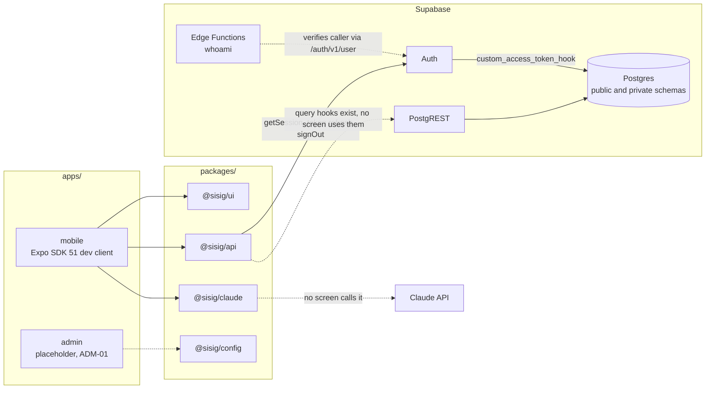
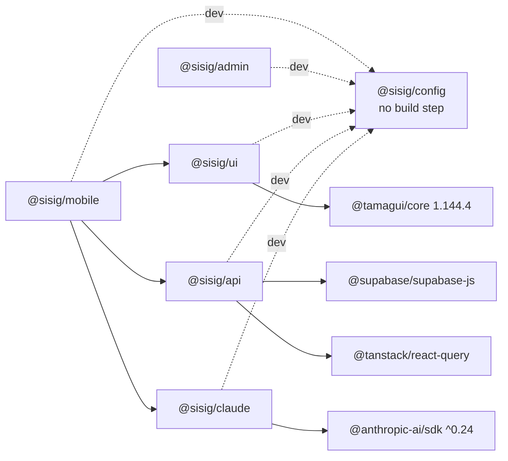
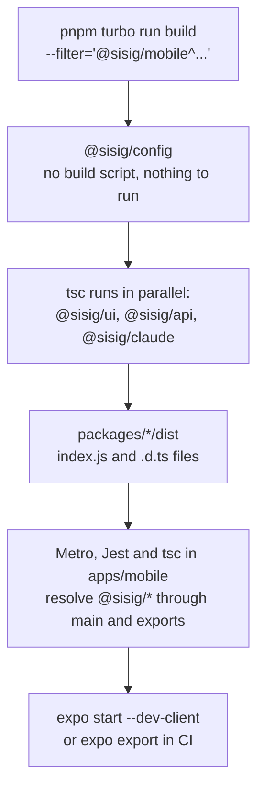
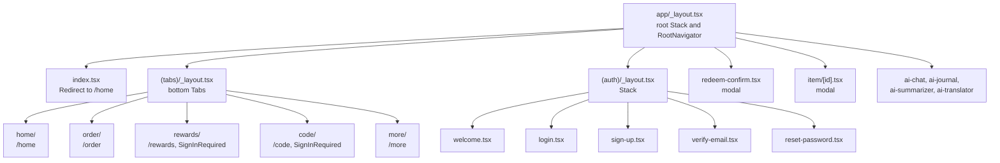
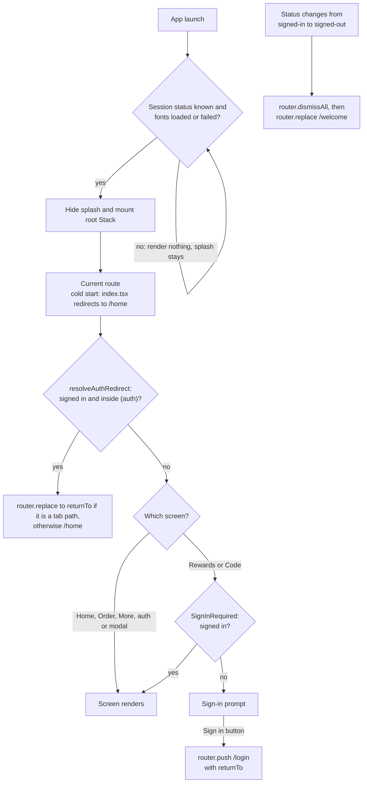
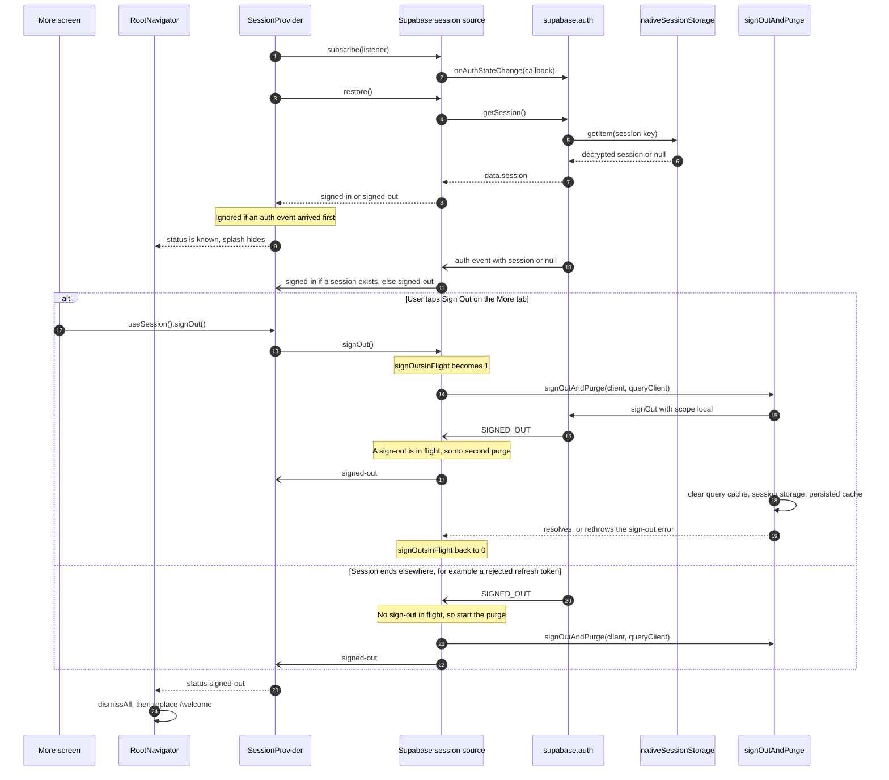
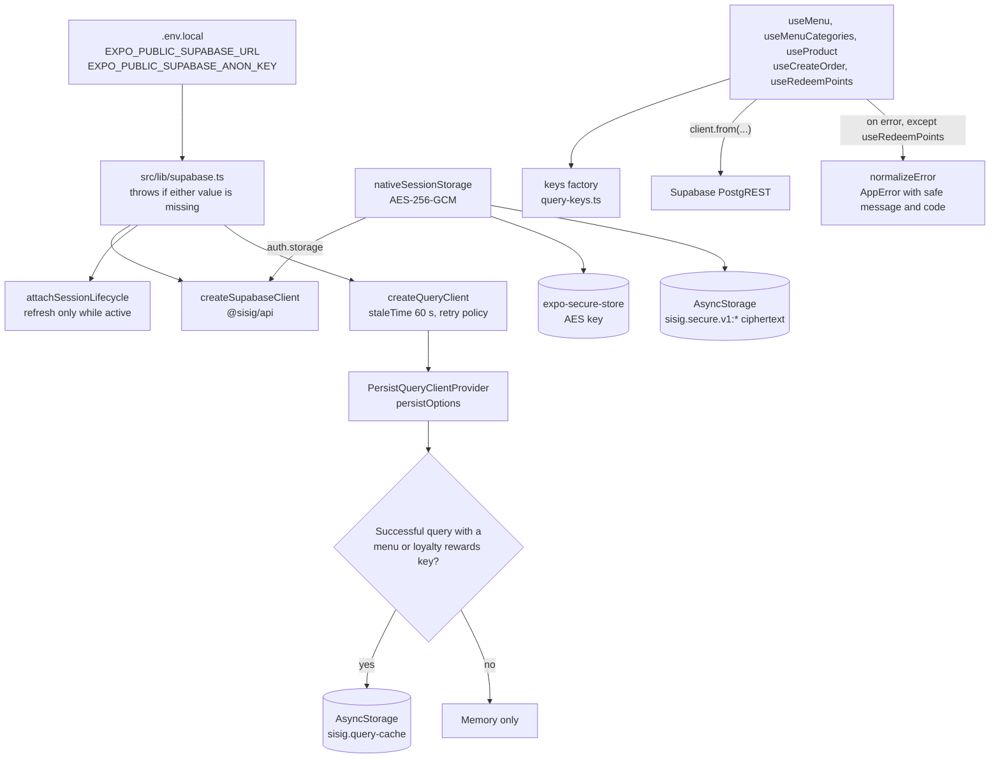
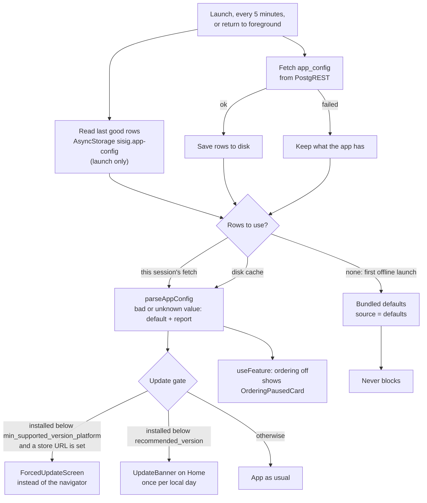
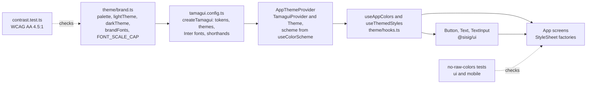

# Sisig Platform Architecture Guide

**Version 1.1** | **Updated:** November 2026 | **Describes:** `main` at `cd47f1e` (PR #19)

This guide explains how the Sisig Eh! rewards app fits together: the apps and packages in the monorepo, how they build, how navigation and sign-in gating work, how the session and data layer behave, and how the theme reaches components. Database detail lives in [SUPABASE.md](SUPABASE.md). Running the app on an Android emulator is covered in [LOCAL-DEVELOPMENT.md](LOCAL-DEVELOPMENT.md).

## Table of Contents

1. [Overview](#overview)
2. [Monorepo and Build Order](#monorepo-and-build-order)
3. [DATA-01: Database Architecture](#data-01-database-architecture)
4. [PLAT-02: Navigation Architecture](#plat-02-navigation-architecture)
5. [PLAT-03: Session and Data Layer](#plat-03-session-and-data-layer)
6. [PLAT-06: Remote Config and Forced Update](#plat-06-remote-config-and-forced-update)
7. [THEME-01: Design System](#theme-01-design-system)
8. [Claude Integration](#claude-integration)
9. [Integration Points](#integration-points)
10. [Development Workflow](#development-workflow)
11. [Deployment Strategy](#deployment-strategy)
12. [Summary of Key Decisions](#summary-of-key-decisions)
13. [Next Steps](#next-steps)
14. [Related Documents](#related-documents)

---

## Overview

Sisig is a mobile-first rewards and ordering app. The repository is a pnpm workspace orchestrated by Turborepo.

| Part | Path | What it is today |
|------|------|------------------|
| Mobile app | `apps/mobile` | Expo SDK 51 (React Native 0.74, React 18.2), Expo Router 3, TypeScript strict mode. Runs as a development build (a "dev client": a debug build of the app with Expo's developer tools). Expo Go is not supported. |
| Admin app | `apps/admin` | A `package.json` only. Every script echoes a placeholder message. The framework choice is planned (ADM-01). |
| `@sisig/ui` | `packages/ui` | Brand tokens, Tamagui config, theme hooks, and the `Button`, `Text` and `TextInput` components. |
| `@sisig/api` | `packages/api` | Supabase client factory, error normalisation, QueryClient factory, query keys, persistence allowlist, menu query hooks, order and redeem mutations, generated database types. |
| `@sisig/claude` | `packages/claude` | A wrapper around `@anthropic-ai/sdk` plus helper functions. No screen calls it yet (see [Claude Integration](#claude-integration)). |
| `@sisig/config` | `packages/config` | Shared `tsconfig.json`, ESLint and Prettier config. |
| Supabase | `supabase/` | Migrations, pgTAP tests, seed data, local stack config, and Edge Functions (`whoami` plus `_shared` helpers). |

Most screens are still placeholders. Home, Order, Rewards and Code show hard-coded sample content, and the auth screens are placeholders until AUTH-01 to AUTH-03. No screen reads data from Supabase yet. Today the app talks to Supabase Auth only: it restores the session, refreshes tokens, and signs out.



Solid arrows are calls the app makes on `main`. Dotted arrows are code that exists but that the app never runs, including the `whoami` Edge Function, which the app does not call yet.

---

## Monorepo and Build Order

`pnpm-workspace.yaml` includes `apps/*` and `packages/*`. Each app depends on shared packages through `workspace:*` versions, so pnpm links them as symlinks into the app's `node_modules`.

| Workspace | Build script | Workspace dependencies |
|-----------|--------------|------------------------|
| `@sisig/mobile` | `expo build` (the local Expo CLI rejects it; release builds are planned, DEVOPS-04) | `@sisig/ui`, `@sisig/api`, `@sisig/claude`; `@sisig/config` (dev) |
| `@sisig/admin` | echo placeholder | `@sisig/config` (dev) |
| `@sisig/ui` | `tsc` to `dist/` | `@sisig/config` (dev) |
| `@sisig/api` | `tsc` to `dist/` | `@sisig/config` (dev) |
| `@sisig/claude` | `tsc` to `dist/` | `@sisig/config` (dev) |
| `@sisig/config` | none | none |



Workspace dependencies come from each `package.json`. Solid arrows are runtime dependencies; dotted arrows are dev dependencies. The bottom row shows the main third-party library behind each package.

### How Turborepo orders the work

`turbo.json` gives `build`, `dev`, `typecheck` and `test` a `^build` dependency: before a task runs in a workspace, Turborepo runs `build` in every workspace it depends on. `build` caches `dist/**`, `.expo/**` and `build/**`.

### How Metro finds the shared packages

There is no `metro.config.js`. Expo's default Metro config (from `expo/metro-config`) detects the workspace root. Each shared package's `package.json` points `main`, `types` and `exports` at `dist/index.js` and `dist/index.d.ts`. So Metro, Jest and `tsc` all read the built output, not `src/`. A fresh clone, or any change under `packages/*/src`, needs a build before Metro can serve it:

```bash
pnpm turbo run build --filter='@sisig/mobile^...'
```

The `^...` suffix selects every workspace the mobile app depends on, but not the app itself, whose `build` script would fail. After you pull new dependencies, restart Metro with `--clear`. CI runs the same build before it bundles the app with `expo export --platform android` (added in PR #16).



The three package builds only depend on `@sisig/config`, so they run side by side. The app reads their `dist/` output, so a stale `dist/` means stale code on the device.

---

## DATA-01: Database Architecture

The full Supabase guide is [SUPABASE.md](SUPABASE.md). Conventions for migrations, policies and functions are in [supabase/CONVENTIONS.md](../supabase/CONVENTIONS.md). In short:

- **Postgres on Supabase.** Forward-only migrations live in `supabase/migrations/`. Never edit an applied migration; add a new one.
- **Row-Level Security (RLS).** Every table created in the `public` schema enables RLS. The `private` schema holds internal functions (for example `custom_access_token_hook`) and is not exposed through PostgREST.
- **Current `public` tables** (from `packages/api/src/database.types.ts`): `profiles`, `user_roles`, `products`, `orders`, `order_items`, `locations`, `loyalty_settings`, `points_ledger`, `point_balances`, `rewards`, `reward_redemptions` and `app_config` (PLAT-06).
- **PR #19 (DATA-04)** dropped `public.users`, the `user_role` enum, and the legacy `loyalty_points` and `loyalty_transactions` tables. Identity now lives in `profiles` and `user_roles` (DATA-02). Loyalty now uses the ledger tables above.
- **Money is integer cents**, with non-negative checks.
- **Points change only through RPCs** (database functions called over PostgREST). The posting and redemption RPCs are planned (LOY-01, LOY-03, LOY-04).
- **Tests and types.** pgTAP tests live in `supabase/tests/database/` (`pnpm db:test`). `pnpm db:types` regenerates the TypeScript types from the local stack, and the CI `types-drift` job fails if the committed file differs.

---

## PLAT-02: Navigation Architecture

The app uses Expo Router 3, which turns files under `apps/mobile/app/` into routes. The entry point is `expo-router/entry` (`main` in `apps/mobile/package.json`). Folders in parentheses, such as `(tabs)` and `(auth)`, are route groups: they share a layout but do not appear in the URL, so `app/(auth)/login.tsx` is `/login`.

### Route tree



Each tab is a folder with its own `_layout.tsx` (a Stack) and an `index.tsx` screen. The Rewards and Code layouts wrap their Stack in `SignInRequired`. No screen links to `item/[id]` or to the four AI routes yet.

### Root layout

`app/_layout.tsx` nests the providers in this order: `AppThemeProvider` (theme), `PersistQueryClientProvider` (query cache with disk persistence), `RemoteConfigProvider` (remote config and the update gate, PLAT-06), `SessionProvider` (session status), then `RootNavigator`.

At module level, `app/_layout.tsx` calls `SplashScreen.preventAutoHideAsync()`, so the splash screen stays up. `RootNavigator` then:

- Renders nothing until the session status is no longer `loading`, the Inter fonts have loaded or failed, and the remote config has read its disk cache (at most 2 seconds). A font failure falls back to the system font.
- Renders `ForcedUpdateScreen` instead of the Stack while the update gate is `blocked`, and skips its navigation effects then (see [PLAT-06](#plat-06-remote-config-and-forced-update)).
- Computes `resolveAuthRedirect` from the status, the route segments and a `returnTo` search parameter, and calls `router.replace` when it returns a path.
- Watches for a change from `signed-in` to `signed-out`. It then calls `router.dismissAll()` and `router.replace('/welcome')`.
- Declares `redeem-confirm` and `item/[id]` as modal screens.

### Auth gating and redirects



Guests can browse Home, Order and More. Rewards and Code show a sign-in prompt instead of their stack. `sanitizeReturnTo` only accepts the five tab paths, so a `returnTo` parameter cannot send a user anywhere else. The login screen is a placeholder until AUTH-01 to AUTH-03, so nobody can sign in from the app yet.

### Tabs

- Five tabs: Home, Order, Rewards, Code, More. Each has a `tabBarAccessibilityLabel` (for example "Rewards tab") and a Material Community icon.
- The Tabs layout hides its own header. Each tab's Stack draws the header with colours from `useStackScreenOptions` (`src/navigation/stack-options.ts`).
- Tapping the active tab pops that tab's stack to its root. `popTabStackToRoot` (`src/navigation/pop-to-root.ts`) dispatches `POP_TO_TOP` to the nested stack only, so other tabs keep their stacks.
- The More tab shows Sign In (opens `/login` with `returnTo=/more`) or Sign Out (calls `useSession().signOut`). Its other menu items only log to the console for now.

### What each screen shows today

| Route | Content on `main` |
|-------|-------------------|
| `/home` | The soft update banner and the announcement banner when the remote config asks for them, then static welcome text, a sample special, "You have 0 points", and a list of quick links. |
| `/order` | Three hard-coded sample items with Add buttons that do nothing, and a $0.00 cart total. While `ordering_enabled` is false, an "Ordering is paused" card with the configured message instead. |
| `/rewards` | Points shown as 0, three sample rewards whose Redeem buttons open `/redeem-confirm`, and a "How it works" card. |
| `/code` | A placeholder QR area and a sample code behind a Show Code toggle. While the code is hidden, a leftover "Sign in to view your code" card with a Sign In button shows, even to signed-in users, and the button does nothing. |
| `/more` | Menu items and the Sign In or Sign Out item. |
| `(auth)` screens | `PlaceholderScreen` with a note saying the real screen is built in AUTH-01 to AUTH-03. Welcome has Log in, Sign up and Continue as guest buttons. |
| `/redeem-confirm`, `/item/[id]` | `PlaceholderScreen` with a note saying the real screen is built in a later ticket. |

### Keep tests out of `app/`

Expo Router treats every file under `app/` as a route, including test files. A test file there gets bundled as a screen and crashes the app on the device with "Property 'jest' doesn't exist". PR #18 moved the only such test to `src/navigation/index-redirect.test.tsx`. Put tests under `src/` and import screens with a relative path such as `../../app/index`.

---

## PLAT-03: Session and Data Layer

The shared code is in `packages/api`. The mobile wiring is in `apps/mobile/src/lib` and `apps/mobile/src/session`. PR #12 isolated the logout purge steps and made key creation single-flight. PR #15 connected the Supabase session source and the purge on sign-out.

### Supabase client

`src/lib/supabase.ts` creates the app's only Supabase client and QueryClient:

1. It reads `EXPO_PUBLIC_SUPABASE_URL` and `EXPO_PUBLIC_SUPABASE_ANON_KEY`. Expo inlines `EXPO_PUBLIC_*` values into the bundle at build time, so only public values may use that prefix. The anon key is Supabase's publishable key. If either value is missing, the module throws when the app starts.
2. `createSupabaseClient(nativeSessionStorage, { url, anonKey })` (`@sisig/api`) calls `createClient` with the encrypted storage adapter, `autoRefreshToken: true`, `persistSession: true` and `detectSessionInUrl: false`.
3. `createQueryClient()` builds the QueryClient.
4. `attachSessionLifecycle(supabase, AppState)` runs token auto-refresh only while the app is in the foreground. It stops refresh when the app goes to the background or becomes inactive, and starts it again when the app is active.

### Encrypted session storage

`src/lib/session-storage.ts` is the `auth.storage` adapter that supabase-js uses for the session:

- A random 256-bit AES key (from `expo-crypto`) is stored in the device keystore through `expo-secure-store`, under `sisig_session_key`, with `AFTER_FIRST_UNLOCK_THIS_DEVICE_ONLY`.
- Every value is encrypted with AES-256-GCM (`@noble/ciphers`) under a fresh 96-bit nonce. The ciphertext goes to AsyncStorage under `sisig.secure.v1:<key>` as JSON with `v`, `iv` and `ct` fields. Tokens never reach AsyncStorage in plaintext.
- Only the key lives in SecureStore, because a Supabase session can be larger than the roughly 2 KB a SecureStore value is meant to hold.
- An entry that fails to decrypt (tampered data, or the key was reset) returns `null` and is deleted, so the user signs in again. A keystore read error returns `null` but keeps the entry.
- Concurrent first writes share one key-creation promise, so two writes cannot each create a key.
- `clearSessionStorage()` removes every sealed entry and two legacy keys, and deletes the AES key. Both steps run even if one fails.

### Session lifecycle

`SessionProvider` (`src/session/session.tsx`) exposes `status` (`loading`, `signed-in` or `signed-out`) and `signOut` through `useSession()`. It takes a `SessionSource` with three methods: `restore`, `subscribe` and `signOut`. The app passes `createSupabaseSessionSource(supabase, queryClient)`, created once at module load in `app/_layout.tsx`.



The source maps every auth event to `signed-in` or `signed-out` by whether a session is present. It purges on every `SIGNED_OUT`, and the in-flight counter stops the `SIGNED_OUT` that its own `auth.signOut` call emits from starting a second purge.

### Logout purge

`signOutAndPurge` (`src/lib/logout.ts`) runs these steps in order:

1. `queryClient.cancelQueries()`.
2. `client.auth.signOut({ scope: 'local' })`. auth-js removes the local session even when the network call fails, and reports that failure as `{ error }` instead of throwing.
3. `queryClient.clear()` (in-memory cache).
4. `clearSessionStorage()` (sealed entries and the AES key).
5. `clearPersistedQueries()` (the query cache on disk).

Steps 3 to 5 each run in their own `try`/`catch`, and a failure is logged, not thrown. A sign-out failure, thrown or returned, is rethrown after the purge, so a purge error never replaces it. Any new per-user store must be added to this function.

### Queries, mutations and the persisted cache

- **QueryClient** (`packages/api/src/query-client.ts`): queries default to a 60-second `staleTime`. `shouldRetryQuery` retries only network and 5xx failures, up to 3 times. Mutations never retry.
- **Query keys** (`packages/api/src/query-keys.ts`): every key comes from the `keys` factory (`auth`, `menu`, `orders`, `loyalty`, `config`, `profile`). Invalidate by prefix, for example `keys.menu.all()`.
- **Query hooks** (`packages/api/src/hooks/useMenu.ts`): `useMenu` (5-minute `staleTime`), `menuCategoriesQueryOptions` and `useMenuCategories` (10 minutes), and `useProduct` (5 minutes). Each takes the Supabase client as an argument.
- **Mutations** (`packages/api/src/mutations.ts`): `useCreateOrder` inserts into `orders` and `order_items` and invalidates `keys.orders.all()`. `useRedeemPoints` always throws `redeem_loyalty_reward RPC is not implemented yet` until the redemption RPC exists (planned, LOY-03). Both keep their invalidation when a caller passes its own `onSuccess` (PR #11). `optimisticUpdate` applies an update and rolls it back on error.
- **Persisted cache** (`apps/mobile/src/lib/query-persistence.ts`): `PersistQueryClientProvider` writes the cache to AsyncStorage under `sisig.query-cache`, unencrypted, with a 24-hour `maxAge` and buster `v1`. Only successful queries whose key starts with an allowlisted prefix are written: `['menu']` and `['loyalty', 'rewards']`. Points, profile, orders and auth are never written to disk, and mutations are never persisted.

No screen calls these hooks or mutations yet.

### Error normalisation

Queries and mutations throw `normalizeError(error)` (`packages/api/src/client.ts`). The exception is `useRedeemPoints`, which makes no request and throws a plain `Error` until its RPC exists. It returns an `AppError` with a fixed, user-safe `message` and a stable `code`. The raw error stays in `details`.

| Source | Condition | `code` |
|--------|-----------|--------|
| PostgREST | empty code (no HTTP response) | `NETWORK_ERROR` |
| PostgREST | `42501` or `PERM` (RLS denied) | `PERMISSION_DENIED` |
| PostgREST | `PGRST301` (JWT rejected) | `SESSION_EXPIRED` |
| PostgREST | `PGRST116` or `NTFND` | `NOT_FOUND` |
| PostgREST | `23505` (unique violation) | `DUPLICATE` |
| PostgREST | any other code | `DATABASE_ERROR` |
| Auth | retryable fetch error / session missing / `invalid_credentials` | `NETWORK_ERROR` / `UNAUTHORIZED` / `INVALID_CREDENTIALS` |
| Auth | `session_not_found` or status 401 / status 500 or more / other | `SESSION_EXPIRED` / `SERVER_ERROR` / `AUTH_ERROR` |
| Edge Functions | HTTP 401 / 403 / 500 or more / other | `UNAUTHORIZED` / `FORBIDDEN` / `SERVER_ERROR` / `FUNCTION_ERROR` |
| Edge Functions | relay error / fetch error | `SERVER_ERROR` / `NETWORK_ERROR` |
| Anything else | | `UNKNOWN_ERROR` |

`isRetryableError` is true only for `NETWORK_ERROR` and `SERVER_ERROR`.



The session is encrypted on disk, while the persisted query cache is plain JSON, which is why only non-personal keys are on its allowlist. The hooks in the middle exist in `@sisig/api`, but no screen uses them yet.

---

## PLAT-06: Remote Config and Forced Update

The restaurant can switch off ordering or receipt scanning and force outdated apps to update without shipping a build. The values live in `public.app_config` (schema and RLS in [SUPABASE.md](SUPABASE.md#remote-config-app_config)). Until the admin team builds toggles, they are changed with SQL: see the [remote config runbook](runbooks/remote-config.md).

### Pieces

| Piece | Where | Job |
|-------|-------|-----|
| `appConfigQueryOptions`, `parseAppConfig`, `DEFAULT_APP_CONFIG` | `packages/api/src/remote-config.ts` | Fetch the raw `key`/`value` rows (key `keys.config.app()`, 5-minute `staleTime` and `refetchInterval`); validate each known key with zod; bundled fail-open defaults |
| `RemoteConfigProvider`, `useRemoteConfig` | `apps/mobile/src/config/remote-config.tsx` | Read the disk cache, fetch, refetch on foreground, save each good fetch, parse, compute the update gate |
| `useFeature('ordering' \| 'receiptScan')` | `apps/mobile/src/config/useFeature.ts` | `{ enabled, message }` for feature screens. The Order tab uses it |
| `evaluateUpdateGate` | `apps/mobile/src/config/update-gate.ts` | `none`, `soft` or `blocked` from the installed version, the platform, the config and its source |
| `getInstalledVersion` | `apps/mobile/src/config/installed-version.ts` | The installed version, from `Constants.expoConfig.version` |
| `setConfigReporter`, `reportConfigIssue` | `apps/mobile/src/config/reporter.ts` | Where config problems go: `console.warn` in development, nothing in release builds until PLAT-04 plugs in Sentry |
| `ForcedUpdateScreen`, `UpdateBanner`, `AnnouncementBanner`, `OrderingPausedCard` | `apps/mobile/src/components/` | The UI, built from `@sisig/ui` `Text` and `Button` |

### Flow



### Rules

- **Fail-open.** A failed fetch never blocks: the app keeps the config it already has. The bundled defaults block nothing (every version `0.0.0`), and the gate ignores them anyway (`source === 'defaults'`). An unknown installed version, a platform other than iOS or Android, and a missing store URL also mean no block. A missing store URL is reported.
- **Blocking from the cache is allowed.** A cached config came from the server, so a cold start offline still shows the update screen if the last good config required it.
- **Per-key validation.** One malformed value falls back to its own default; the other keys still apply. Unknown keys are ignored. Each distinct problem goes to the reporter once per app session. Store links must be https on `apps.apple.com` or `play.google.com`, and the Uber Eats link on `ubereats.com`, because the blocking screen opens them with `Linking.openURL`.
- **Own disk cache.** The config is saved under `sisig.app-config`, not in the TanStack persisted cache, because that one expires after 24 hours and is cleared on logout. The config is not personal data, so `signOutAndPurge` leaves it. The once-a-day banner date (`sisig.update-banner.last-shown`) is device-wide too.
- **Within 5 minutes or on next foreground.** The query refetches every 5 minutes while the app runs, and `RemoteConfigProvider` refetches on every change to `active`. TanStack's `focusManager` is not wired to `AppState`, so the provider does this itself, for the config only.
- **Not blocking the navigator.** The forced-update screen replaces the Stack rather than sitting on top of it, so modal routes cannot cover it and there is no back gesture to dismiss it.
- **Banner day counted on first render.** `UpdateBanner` records the day when it first renders on Home, even if another tab is in front, so a customer can miss that day's banner. It still never shows more than once a day.
- **Hooks from `@sisig/api` and React copies.** `@sisig/api` resolves React 18.3 while the app uses 18.2, so the app calls its own `useQuery` with `appConfigQueryOptions` instead of a hook exported from the package.

### Limitations

- **Installed version.** `expo-application` is not installed, and adding a native module needs a dev client rebuild. `getInstalledVersion()` reads `Constants.expoConfig.version`, the `version` from `app.json` embedded at build time. That is the installed build's version while the app has no `expo-updates`. When DEVOPS-05 adds `expo-updates` (OTA updates and `runtimeVersion`), switch the seam to `Application.nativeApplicationVersion`. OTA JS compatibility is DEVOPS-05's job, not this gate's.
- **Sentry.** Problems are not sent to Sentry yet. PLAT-04 initialises Sentry and calls `setConfigReporter`.
- **Receipt scanning** has no screen yet, so `useFeature('receiptScan')` has no caller. `uber_eats_url` is validated but not shown.
- **Admin toggles** are not built (admin team). `is_admin()` reads the token, so a demoted admin keeps write access until their token expires.

---

## THEME-01: Design System

### Design Philosophy

**Principle:** semantic tokens define appearance. Components reference semantic names such as `primary` or `foregroundMuted`, never raw colours.



Brand values live only in `brand.ts`. The Tamagui config turns them into themes, the provider picks light or dark from the OS, and the hooks hand resolved colours to components and screens. Two tests guard the chain.

### Tokens

`packages/ui/src/theme/brand.ts` has three layers:

- `palette`: the raw hex values. `tamagui.config.ts` registers them as Tamagui colour tokens, and the themes map semantic names to them. Components use the semantic names, not palette entries.
- `SEMANTIC_TOKENS`: 20 names (`background`, `surface`, `surfaceMuted`, `foreground`, `foregroundMuted`, `placeholder`, `border`, `primary`, `primaryPressed`, `primaryForeground`, `accent`, `accentForeground`, `success`, `successForeground`, `warning`, `warningForeground`, `danger`, `dangerForeground`, `bubble`, `bubbleForeground`).
- `lightTheme` and `darkTheme`: each maps every semantic name to a palette value.

All values are placeholders until the client's brand palette and fonts arrive.

### Tamagui Configuration

- `packages/ui/src/tamagui.config.ts` calls `createTamagui` with size, space, radius and zIndex tokens, `palette` as the colour tokens, the `light` and `dark` themes, Tamagui shorthands, and `heading` and `body` fonts built with `createInterFont`. Settings include `allowedStyleValues: 'somewhat-strict'` and `disableRootThemeClass: true`.
- Tamagui is pinned at 1.144.4 to stay on React 18.2, which the app runs.
- The file declares `TamaguiCustomConfig` so Tamagui's types know the config:

```typescript
declare module '@tamagui/core' {
  interface TamaguiCustomConfig extends Conf {}
}
```

### Using colours in components

Components do not use Tamagui styled components today. They build React Native styles from resolved semantic colours:

```typescript
import { StyleSheet } from 'react-native';
import { Text, useThemedStyles, type AppColors } from '@sisig/ui';

const createStyles = (c: AppColors) =>
  StyleSheet.create({
    title: { color: c.primary },
  });

export function Title(): JSX.Element {
  const styles = useThemedStyles(createStyles);
  return <Text style={styles.title}>Buy now</Text>;
}
```

`useAppColors()` reads the active Tamagui theme and returns every semantic colour. `useThemedStyles(factory)` rebuilds the styles only when the theme changes. Keep the factory at module level.

### Dynamic Type Support

`Text` and `TextInput` from `@sisig/ui` set `maxFontSizeMultiplier` to `FONT_SCALE_CAP` (1.5) and clamp any larger value a caller passes. Text grows with the OS font size setting up to 1.5x, so layouts keep their shape. App code must use these wrappers, not the React Native components.

### Light/Dark Theme Switching

`apps/mobile/src/components/AppThemeProvider.tsx` reads `useColorScheme()`, sets the Tamagui theme, and sets the status bar style. It switches while the app runs. There is no in-app override in v1. `app.json` sets `userInterfaceStyle: "automatic"`.

### Fonts

The placeholder fonts are Inter 400 and 600 from `@expo-google-fonts/inter`. They are embedded at build time through the `expo-font` plugin in `apps/mobile/app.json` and loaded at runtime with `useFonts` in `app/_layout.tsx`. The font keys must match `brandFonts`.

### Contrast and raw-colour tests

- `packages/ui/src/theme/contrast.test.ts` checks that both themes define every semantic token, and that 26 foreground/background pairs reach WCAG AA 4.5:1 in both themes. Only the decorative `border` token is not covered. It runs under `pnpm test`, which CI runs on every pull request.
- `packages/ui/src/no-raw-colors.test.ts` and `apps/mobile/src/no-raw-colors.test.ts` fail if a non-test `.ts` or `.tsx` file (other than `brand.ts`) contains a quoted hex colour such as `'#FFFFFF'`.

### Rebrand

1. Change the values in `packages/ui/src/theme/brand.ts` (`palette`, `lightTheme`, `darkTheme`). Run `pnpm test`: the contrast test fails if any pair falls below AA.
2. Replace the Inter placeholders: update `brandFonts` in the same file, the font files listed under the `expo-font` plugin in `apps/mobile/app.json`, and the font imports in `apps/mobile/app/_layout.tsx`.
3. Rebuild and check:

```bash
pnpm -F @sisig/ui build
pnpm test
pnpm -F @sisig/mobile typecheck
```

Screens pick up the new colours with no component changes.

---

## Claude Integration

`@sisig/claude` wraps `@anthropic-ai/sdk` (`^0.24`) in a `ClaudeClient` class and adds translation, code-analysis and document-generation helpers. In the app:

- `app/ai-chat.tsx`, `ai-journal.tsx`, `ai-summarizer.tsx` and `ai-translator.tsx` are UI only. They show fixed placeholder text and make no API call. `ai-chat` uses `ConversationManager` (local message history) and `ai-translator` uses `SUPPORTED_LANGUAGES`. No screen links to these routes.
- `src/hooks/useAI.ts` and `src/hooks/useImageAnalysis.ts` exist, but no screen uses them. `useImageAnalysis` never calls the API.

> **Warning:** `ClaudeClient` reads `ANTHROPIC_API_KEY` from `process.env` when no key is passed. Expo inlines only `EXPO_PUBLIC_*` variables, so that value is not in the app bundle, and `new ClaudeClient()` throws in the app. Do not work around this with an `EXPO_PUBLIC_` variable or by passing a key to `useAI`: anything in the bundle can be extracted from the installed app.

The package and its limits are documented in [packages/claude/README.md](../packages/claude/README.md) and [CLAUDE_SKILLS.md](../CLAUDE_SKILLS.md).

---

## Integration Points

### Database to frontend types

1. Migrations define the schema.
2. `pnpm db:types` generates `packages/api/src/database.types.ts` from the local Supabase stack.
3. Code imports the types with `import type { Database } from '@sisig/api'`, and the hooks use `SupabaseClient<Database>`.
4. The CI `types-drift` job regenerates the file and fails if it differs from the committed one.

### Auth to database

The local stack config (`supabase/config.toml`) enables a custom access token hook, `private.custom_access_token_hook`, which adds an `app_role` claim to access tokens. See [SUPABASE.md](SUPABASE.md).

### Edge Functions

`supabase/functions/whoami` answers `GET` with the caller's id, email and app role, after it verifies the caller's token against `/auth/v1/user`. Shared helpers for auth, CORS and error envelopes are in `supabase/functions/_shared`. The mobile app does not call any Edge Function yet. When it does, `normalizeError` already maps Functions errors.

### Theme to components

See the diagram in [THEME-01: Design System](#theme-01-design-system).

---

## Development Workflow

### Getting Started

The step-by-step setup, including the Android emulator, is in [LOCAL-DEVELOPMENT.md](LOCAL-DEVELOPMENT.md). In short:

```bash
pnpm install

# Create apps/mobile/.env.local (gitignored) with
# EXPO_PUBLIC_SUPABASE_URL and EXPO_PUBLIC_SUPABASE_ANON_KEY

# Build the shared packages that Metro reads from dist/
pnpm turbo run build --filter='@sisig/mobile^...'

# First run: build and install the dev client, then start Metro
pnpm -F @sisig/mobile exec expo run:android

# Later runs: start Metro for the installed dev client
pnpm -F @sisig/mobile dev
```

The team runs the app on an Android emulator against the hosted Supabase dev project. iOS is not set up yet, because it needs a full Xcode install. A local Supabase stack (`pnpm db:start`, Docker required) is only needed for database work. See [SUPABASE.md](SUPABASE.md).

### Creating a New Feature

1. **Schema (if needed).** Run `pnpm db:new <name>`, write the migration with RLS policies, then `pnpm db:reset` and `pnpm db:types`. Follow [supabase/CONVENTIONS.md](../supabase/CONVENTIONS.md). Points, redemptions and orders change only through RPCs or Edge Functions.
2. **Data access.** Add keys to the `keys` factory. Add a `xxxQueryOptions(client)` function and a thin `useXxx` hook in `packages/api`, and throw `normalizeError(error)`. Rebuild the package.
3. **Screen.** A new tab is a folder `app/(tabs)/<name>/` with a `_layout.tsx` (a Stack using `useStackScreenOptions`) and an `index.tsx`, plus a `Tabs.Screen` in `app/(tabs)/_layout.tsx`. Add its path to `TAB_PATHS` in `src/navigation/auth-gate.ts` if it should be a `returnTo` target. Wrap the stack in `SignInRequired` if guests must not see it.
4. **Tests.** Put them under `src/`, never under `app/`.
5. **Checks.** Run `pnpm lint`, `pnpm typecheck`, `pnpm test` and, for schema changes, `pnpm db:test`.
6. **Branch and pull request.** Follow [CONTRIBUTING.md](../CONTRIBUTING.md).

### Testing Strategy

| Layer | Tool | Command |
|-------|------|---------|
| Database | pgTAP | `pnpm db:test` |
| Edge Functions | Deno test | `deno test --allow-all --no-config supabase/functions` |
| `@sisig/api`, `@sisig/claude` | Jest with ts-jest | `pnpm -F @sisig/api test`, `pnpm -F @sisig/claude test` |
| `@sisig/ui`, `@sisig/mobile` | Jest with jest-expo and React Native Testing Library | `pnpm -F @sisig/ui test`, `pnpm -F @sisig/mobile test` |
| Types | TypeScript | `pnpm typecheck` |
| Linting | ESLint | `pnpm lint` |
| Formatting | Prettier | `pnpm format:check` |
| App bundle | `expo export` | see the CI step in [DEVOPS-02-CI.md](DEVOPS-02-CI.md) |

`pnpm test` runs every workspace's tests through Turborepo. The mobile and UI tests import `@sisig/*` from `dist/`, so build the packages first when you run a workspace's tests directly.

---

## Deployment Strategy

### Mobile App

1. **Local dev client.** `pnpm -F @sisig/mobile exec expo run:android` builds a debug app with a native project, installs it on the emulator or device, and starts Metro. `expo run:ios` does the same on iOS but needs Xcode, and has not been set up. Both commands generate `apps/mobile/android` and `apps/mobile/ios`. Those folders are local build output and are not committed.
2. **Release builds.** Not configured. The local Expo CLI rejects `expo build`, and there is no `eas.json`. App Store and Play Store builds through EAS (Expo Application Services) are planned (DEVOPS-04).

### Database

Migrations apply when the local stack starts or resets (`pnpm db:start`, `pnpm db:reset`). The CI `database` job runs pgTAP tests and `pnpm db:lint` on every pull request. How changes reach the hosted project is described in [SUPABASE.md](SUPABASE.md).

### Environment Management

| Environment | Database | Used for |
|-------------|----------|----------|
| Local | `supabase start` (Docker) | Database work, pgTAP tests, type generation |
| Hosted dev project | Supabase cloud | Running the app on the Android emulator |

No staging or production environment is defined in this repository.

---

## Summary of Key Decisions

| Decision | Rationale | Trade-off |
|----------|-----------|-----------|
| RLS on every public table | Access control lives in the database | A missing policy means no access |
| Money in integer cents | No floating-point errors | Convert to dollars in the UI |
| Points change only through RPCs | One audited path for balance changes | Redeem waits on the LOY-03 RPC |
| Shared packages consumed from `dist/` | Metro, Jest and `tsc` read one built entry point | Build packages before starting Metro |
| Encrypted session, key in SecureStore | Tokens never sit in AsyncStorage as plaintext | More moving parts on sign-out |
| Purge on every `SIGNED_OUT` | A session that ends elsewhere also clears the device | Needs the in-flight guard to avoid a double purge |
| Persist only allowlisted query keys | No personal data in the unencrypted cache | New keys need a deliberate allowlist decision |
| Semantic tokens | Brand swaps without component changes | An extra layer of indirection |
| Expo Router file-based routes | Routes and deep links follow the file tree | Every file in `app/` becomes a route, tests included |
| Five-tab navigation with per-tab stacks | Fast access; each tab keeps its own history | Limited room for more top-level sections |
| Development build, not Expo Go | Native config and plugins are applied at build time | Each native change needs a new dev client build |
| Remote config is fail-open | A failed fetch or a bad value never locks customers out | A config the app cannot read cannot block an old version either |

---

## Next Steps

Planned work named in the code and docs:

- **AUTH-01 to AUTH-03:** the real welcome, login, sign-up, email verification and password reset screens.
- **AUTH-05:** member deletion and anonymisation (the ledger already allows it).
- **LOY-01, LOY-03, LOY-04:** RPCs that post points and handle redemptions. `useRedeemPoints` waits on LOY-03.
- **LOY-06:** client sign-off on loyalty rules; `loyalty_settings` values are placeholders until then.
- **ADM-01:** admin app framework. The admin team also builds the `app_config` toggles (PLAT-06).
- **PLAT-04:** Sentry setup, including `setConfigReporter` for remote-config problems.
- **DEVOPS-05:** OTA updates and `runtimeVersion`; switch `getInstalledVersion()` to `expo-application` then.
- **DEVOPS-04:** release builds through EAS.
- Client brand assets: swap the values in `packages/ui/src/theme/brand.ts`, then rebuild.

---

## Related Documents

- [SUPABASE.md](SUPABASE.md): the Supabase guide (schema, migrations, RLS, Edge Functions).
- [LOCAL-DEVELOPMENT.md](LOCAL-DEVELOPMENT.md): local setup and the Android emulator.
- [DEVOPS-02-CI.md](DEVOPS-02-CI.md): the CI pipeline.
- [supabase/README.md](../supabase/README.md) and [supabase/CONVENTIONS.md](../supabase/CONVENTIONS.md): database commands and conventions.
- [apps/mobile/README.md](../apps/mobile/README.md): the mobile app.
- [CONTRIBUTING.md](../CONTRIBUTING.md): branching, commits and pull requests.
- [CLAUDE_SKILLS.md](../CLAUDE_SKILLS.md) and [packages/claude/README.md](../packages/claude/README.md): the Claude package.

---

**Document maintained by:** Dev Team
**Last updated:** November 2026
