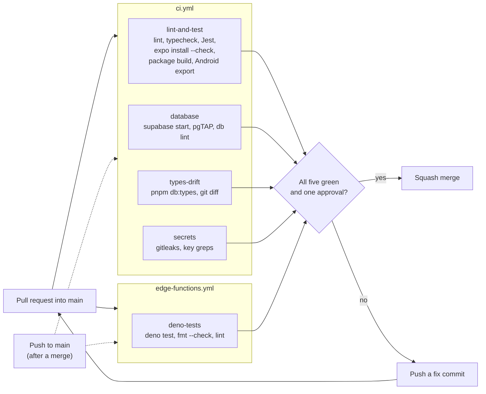

# DEVOPS-02: GitHub Actions CI Pipeline

**Plan ID:** DEVOPS-02 | **Epic:** DEVOPS | **Owner:** DEV-C | **Status:** Code complete. Required checks are not yet enforced on `main` (manual step below).

## Overview

Every pull request into `main` runs automated checks for code quality, the mobile bundle, database integrity, and leaked secrets. Every push to `main` runs them again. A failing check blocks a merge only after branch protection on `main` requires it (see [Required status checks](#required-status-checks-manual-github-setting)), and that is not configured yet.

## Architecture



Both workflows start on every pull request into `main` and on every push to `main`. The five jobs run in parallel, with no dependencies between them. The merge gate is a team rule until branch protection requires the five checks; the dotted push run re-checks `main` after a merge and gates nothing.

| Workflow | File | Triggers | Jobs |
|---|---|---|---|
| CI | `.github/workflows/ci.yml` | `pull_request` to `main`, `push` to `main` | `lint-and-test`, `database`, `types-drift`, `secrets` |
| Edge Functions | `.github/workflows/edge-functions.yml` | `pull_request` to `main`, `push` to `main` | `deno-tests` |

Neither workflow has a path filter, `workflow_dispatch` or a `concurrency` group. Every PR runs every job, and a new push to a PR does not cancel the run for the previous push.

## Workflows

### 1. CI (`.github/workflows/ci.yml`)

**Triggers:** `pull_request` and `push` to `main`. No path filter, so every PR runs every job.

All four jobs run on `ubuntu-latest`. Durations below are from run 42338504203 (the push to `main` for PR #19, 2026-11-07 04:27 UTC).

#### Job 1: `lint-and-test`
- **Timeout:** 15 minutes. **Measured duration:** 73 seconds.
- **Steps, in order:**
  1. `actions/checkout@v4`
  2. `pnpm/action-setup@v2` with pnpm 9
  3. `actions/setup-node@v4` with Node 18 and `cache: pnpm` (the pnpm store)
  4. **Restore Turborepo cache:** `actions/cache@v4` on `.turbo/cache` (see [Caching](#caching))
  5. **Install dependencies:** `pnpm install --frozen-lockfile`
  6. **Lint:** `pnpm lint` (ESLint in every workspace that has the script; `apps/admin` is a placeholder)
  7. **Type check:** `pnpm typecheck` (`tsc --noEmit`; Turborepo runs the `build` tasks of the workspace packages before it (the `^build` dependency in `turbo.json`). The root scripts also pass the deprecated `--parallel` flag; in a timing check with Turborepo 2.11.10 and no cache, dependent tasks still started only after the builds finished)
  8. **Unit tests:** `pnpm test` (Jest in every workspace that has the script)
  9. **Check Expo dependencies:** `pnpm -F @sisig/mobile exec expo install --check`. Fails if an installed package version does not match what Expo SDK 51 expects. It compares versions only.
  10. **Build workspace dependencies of the mobile app:** `pnpm turbo run build --filter='@sisig/mobile^...'`. Builds the `dist/` entry points of the `@sisig/*` packages the app imports. Step 7 already built them; this step keeps step 11 working if it ever runs on its own.
  11. **Bundle mobile app (Android export):** `pnpm -F @sisig/mobile exec expo export --platform android --output-dir ../../.expo-export-check`. A full Metro bundle of the app. It catches what step 9 cannot: a missing entry point, an undeclared or mis-pinned package, an import Metro cannot resolve. The output goes to `.expo-export-check/` at the repo root, which is git-ignored and not kept.

Step 9 has been in the job since the first DEVOPS-02 pipeline. PR #16 added steps 10 and 11 (and the Anthropic key check in `secrets`), after the app failed to bundle on a clean clone while step 9 stayed green.

#### Job 2: `database`
- **Timeout:** 15 minutes. **Measured duration:** 134 seconds.
- **Steps:** checkout; `npm install -g supabase@2.122.0`; **Start Supabase:** `supabase start -x realtime` (the Realtime container is skipped), retried only on Docker registry rate limits (see [Troubleshooting](#troubleshooting)); **Wait for database:** `sleep 5` then `supabase status`; pnpm 9; Node 18 with the pnpm cache; `pnpm install --frozen-lockfile`; **Run pgTAP tests:** `pnpm db:test` (`supabase test db`, runs `supabase/tests/database/*.sql`); **Lint database schema:** `pnpm db:lint` (`supabase db lint --local --schema public,private --fail-on error`). The `extensions` schema is not linted, because pgTAP's own functions there fail lint.
- **Database:** the Supabase CLI starts its own Postgres container in Docker. The job does not use a separate PostgreSQL service. On a fresh database, `supabase start` applies every file in `supabase/migrations/` and then `supabase/seed.sql` (the log shows "Seeding data from supabase/seed.sql..."). The pgTAP tests run against that database, and `07_locations.sql` asserts the seeded placeholder store, so a broken seed fails this job.

#### Job 3: `types-drift`
- **Timeout:** 15 minutes. **Measured duration:** 128 seconds.
- **Steps:** the same Supabase CLI install, start and wait as `database`; pnpm and Node setup; `pnpm install --frozen-lockfile`; **Generate types:** `pnpm db:types` (generates `packages/api/src/database.types.ts` from the local `public` schema); **Check for uncommitted type changes:** `git diff --quiet packages/api/src/database.types.ts`. On a difference it prints the diff and "Run 'pnpm db:types' and commit the changes", then fails.

#### Job 4: `secrets`
- **Timeout:** 5 minutes. **Measured duration:** 7 seconds.
- **Checks, in workflow order:**
  1. **gitleaks scan:** `gitleaks/gitleaks-action@v2` with default rules. It scans the commits of the push or pull request, not the whole history: run 42338504203 used `--log-opts=-1` and logged "1 commits scanned". `fetch-depth: 0` only makes the history available. Fails on a detected key or token.
  2. **Service-role key or JWT pattern:** `git grep -F` for the HS256 JWT header `eyJhbGciOiJIUzI1NiIsInR5cCI6IkpXVCJ9` in `apps/` and `packages/`.
  3. **Anthropic API key pattern:** `git grep -E` for `sk-ant-` followed by 20 or more key characters in `apps/` and `packages/`. Placeholders such as `sk-ant-...` in the READMEs do not match. `ANTHROPIC_API_KEY` itself is not checked, because client code references it legitimately.
  4. **`SUPABASE_SERVICE_ROLE_KEY` references:** `git grep -F` for that name in `apps/` and `packages/`.

  Checks 2 to 4 pass only when `git grep` exits 1 (no match). A match (exit 0) and any other exit code (a grep error) both fail. The JWT header in check 2 matches every HS256 JWT, including Supabase's legacy anon key, so Supabase keys must come from environment configuration (`apps/mobile/.env.local`), never from source.

### 2. Edge Functions (`.github/workflows/edge-functions.yml`)

**Triggers:** `pull_request` and `push` to `main`, with no path filter on purpose. `deno-tests` is meant to be a required check, and a path-filtered workflow reports no status on PRs outside its paths, which would leave a required check pending forever.

#### Job: `deno-tests`
- **Timeout:** 10 minutes. **Measured duration:** about 7 seconds (run 42338504195, same push).
- **Steps:** checkout; `denoland/setup-deno@v1` with Deno `v2.x`; **Run Deno tests:** `deno test --allow-all --no-config supabase/functions`; **Format check:** `deno fmt --check --no-config supabase/functions`; **Lint:** `deno lint --no-config supabase/functions`.

### Removed: `required-status-checks.yml`

This placeholder read the conclusion of other workflow runs on `main`, and enforced nothing. Results of `workflow_run` runs do not attach to pull request checks, so it never blocked a merge. It was deleted in DEVOPS-02.

## Required status checks (manual GitHub setting)

**Not configured yet.** Checked again on 2026-11-06: `gh api repos/Alexd2004/Sisig/branches/main/protection` returns 404 "Branch not protected", and `gh api repos/Alexd2004/Sisig/rulesets` returns an empty list. A repository admin must set this in **Settings > Branches > Branch protection rule** for `main`:

- Require status checks to pass before merging, and select `lint-and-test`, `database`, `types-drift`, `secrets` and `deno-tests`.
- Require a pull request with at least one approval, and block force pushes. These belong to DEVOPS-03 (see [CONTRIBUTING.md](../CONTRIBUTING.md#branch-protection)).

The check names are the job IDs above. GitHub offers a check as selectable only after it has run at least once on the repository, which has happened for all five.

## Local Development

### Running CI checks locally

The database jobs need Docker, and the first `pnpm db:start` pulls the Supabase images. Docker is not installed on the team's Mac, so those jobs are checked in CI. The other jobs run without Docker.

1. `lint-and-test`:

   ```bash
   pnpm install --frozen-lockfile
   pnpm lint
   pnpm typecheck
   pnpm test
   ```

   ```bash
   pnpm -F @sisig/mobile exec expo install --check
   ```

   ```bash
   pnpm turbo run build --filter='@sisig/mobile^...'
   pnpm -F @sisig/mobile exec expo export --platform android --output-dir ../../.expo-export-check
   ```

2. `database` (Docker required):

   ```bash
   pnpm db:start
   pnpm db:reset
   pnpm db:test
   pnpm db:lint
   ```

3. `types-drift` (Docker required). `git diff --exit-code` exits 1 when the regenerated file differs; commit it if so:

   ```bash
   pnpm db:types
   git diff --exit-code packages/api/src/database.types.ts
   ```

   If the local stack is not running, `pnpm db:types` exits 1 and leaves the committed file unchanged.

4. `deno-tests` (install Deno 2 first):

   ```bash
   deno test --allow-all --no-config supabase/functions
   deno fmt --check --no-config supabase/functions
   deno lint --no-config supabase/functions
   ```

5. `secrets` (install gitleaks first: `brew install gitleaks`):

   ```bash
   gitleaks detect
   ```

   ```bash
   git grep -n -I -F -e "eyJhbGciOiJIUzI1NiIsInR5cCI6IkpXVCJ9" -e "SUPABASE_SERVICE_ROLE_KEY" -- apps packages
   git grep -n -I -E -e "sk-ant-[A-Za-z0-9_-]{20,}" -- apps packages
   ```

   `git grep` searches tracked files only, so stage new files before you run it. No output means clean.

## Common Failures & Fixes

**Type drift detected**

The migrations changed the `public` schema, but the committed types were not regenerated. With the local stack running (Docker):

```bash
pnpm db:start
pnpm db:types
git diff packages/api/src/database.types.ts
```

Commit the regenerated file on your branch with a Jira-scoped message, for example `chore(DATA-04): regenerate database types`.

**Migration or pgTAP test fails**

Read the test output. If the migration is already on `main` or applied to the hosted project, fix it with a new migration; never edit an applied migration (see [supabase/CONVENTIONS.md](../supabase/CONVENTIONS.md)). Then run `pnpm db:reset && pnpm db:test`.

**Schema lint fails**

`supabase db lint --schema public,private --fail-on error` reported an error. Fix the reported object, then run `pnpm db:reset && pnpm db:lint`. Check that the error is in our schemas, not pgTAP internals (the `extensions` schema is not linted).

**`expo install --check` fails**

A dependency in `apps/mobile/package.json` is outside the range Expo SDK 51 expects. The step's log names the package and the expected version. Align the version, run `pnpm install`, and commit `pnpm-lock.yaml` with it.

**Android export fails**

Metro could not bundle the app. Typical causes: an import of a package that `apps/mobile/package.json` does not declare (pnpm does not expose undeclared packages), a version pinned outside the SDK 51 line, or a test or helper file under `apps/mobile/app/` (Expo Router bundles every file there as a route). Reproduce with the export commands in [Running CI checks locally](#running-ci-checks-locally).

**Lint error**

Fix the ESLint findings from `pnpm lint`. `pnpm format` applies Prettier formatting only.

**Secret detected**

A secret that reached a commit stays in git history. Rotate it first, then remove it from the code. Deleting it in a later commit is not enough.

**Service-role key or reference found**

Move the value to a server-side Edge Function or to environment configuration. `SUPABASE_SERVICE_ROLE_KEY` must not appear in `apps/` or `packages/`.

## Performance

### Caching

- **pnpm store:** `actions/setup-node` with `cache: pnpm`, in every job that installs packages (`lint-and-test`, `database`, `types-drift`).
- **Turborepo:** only `lint-and-test` restores `.turbo/cache` (Turborepo's local cache directory) with `actions/cache@v4`. The key is `turbo-<os>-<run_id>`, so each run saves a new entry; the restore key `turbo-<os>-` makes the next run restore the most recent one. Turborepo then replays cached output for tasks whose inputs did not change. In run 42338504203, 4 of 5 lint tasks and 5 of 8 typecheck tasks were cache hits.
- **Not cached:** the Supabase Docker images (pulled on every `database` and `types-drift` run) and the Deno toolchain.
- CI does not filter to affected packages. Every task runs on every PR, and unchanged tasks replay from cache.

### Measured durations

Run 42338504203 (push to `main` for PR #19): `lint-and-test` 73 seconds, `database` 134 seconds, `types-drift` 128 seconds, `secrets` 7 seconds; `deno-tests` about 7 seconds in the Edge Functions run. Jobs run in parallel, so the wall clock was about 2.3 minutes.

Median over the last 10 CI runs up to that one, including one failed run (`gh run list --workflow CI`): about 2.4 minutes. Target: under 10 minutes.

## Security

### gitleaks

Detects leaked secrets with its default rules (AWS keys, GitHub tokens, Slack webhooks and others) in the commits of each push or pull request. It does not rescan the whole history. Fails the PR when it finds one. There is no `.gitleaksignore` yet.

### Service-role key and JWT check

See `secrets` checks 2 to 4 above. Client code (`apps/`, `packages/`) must never contain the service-role key. `supabase/` is excluded on purpose, because Edge Functions run server-side and may use it.

## Monitoring & Alerts

GitHub Actions shows each job's duration, its failures and their logs. There are no alerts beyond GitHub's own notifications.

### Re-running CI

If a job fails for a reason unrelated to the change (rare flakiness), open the PR, click "Details" on the failed check and choose "Re-run jobs". Investigate any repeated failure.

## Expansion (Future)

### DEVOPS-04: Build & Deploy
- `pnpm build` for the mobile and admin apps (today the mobile `build` script is `expo build`, which the local Expo CLI rejects)
- `eas build` cloud builds (EAS CLI; not configured yet, there is no `eas.json`)
- Deploy to Vercel (admin) and to the App Store and Play Store (mobile)

### Data Migration Testing
Once DATA-14 (audit logging) lands: test that audit trails are created and that historical data stays accessible.

### Migrations to the hosted project
CI tests migrations on a throwaway local database only. Nothing applies them to the hosted Supabase dev project; that is a manual `supabase db push` after merge (see [CONTRIBUTING.md](../CONTRIBUTING.md#database-changes) and [docs/SUPABASE.md](./SUPABASE.md)).

## Known Gaps

- **Branch protection is not configured.** Until it is, none of these checks blocks a merge.
- **Merge methods are not restricted.** The repository still allows merge commits and rebase merges next to squash merges, and does not delete head branches after merge.
- **`pnpm format:check` is not run in CI.** It fails on `main` today. Checked on 2026-11-06, Prettier reports 14 files in `packages/api`, 10 in `packages/claude`, 13 in `packages/ui` and 53 in `apps/mobile`. Prettier finds no config file for those sources (`prettier --find-config-path` reports none; the shared `packages/config/prettier.config.js` is not referenced), so it checks them against its defaults. CONTRIBUTING.md does not list it as a required check.
- **Behavioural RLS coverage is partial.** `supabase/tests/database/` has 11 files. `01_init.sql` and `02_identity.sql` are structural: they check that tables, columns, functions, constraints and policy names exist. The other nine also run statements and assert the results, and five of them (`03`, `06`, `09`, `10`, `11`) switch roles with `set local role` to test RLS as `anon`, `authenticated` or `service_role`. Behavioural RLS tests for every table belong to DATA-08.
- **The `db lint` gate found real problems on its first run.** On commit 45398aa the `database` job failed on `public.set_user_role`, which raised the invalid error code `PERM` (fixed by forward-only migration `20261029120000_fix_set_user_role_error_codes.sql`). The same run reported nine findings from pgTAP's own functions in the `extensions` schema, so the lint covers `public,private` only.
- **No affected-only runs.** Turborepo runs every task on every PR.
- **No `concurrency` group.** Pushing twice to a PR runs both CI runs to the end.
- **CI runs Node 18,** which reached end of life in April 2025. Upgrading is a separate change.
- **Action versions are behind.** GitHub warns that `actions/checkout@v4`, `actions/setup-node@v4` and `pnpm/action-setup@v2` target Node.js 20, which is deprecated on its runners, and runs them on Node.js 24 instead.

## Troubleshooting

### CI flaky or timing out

1. The `database` and `types-drift` jobs retry `supabase start` only when the log contains "Data limit exceeded" (the public.ecr.aws registry rate limit on shared runners): three attempts, 90 seconds apart, with `supabase stop --no-backup` between them. Any other start failure fails the job at once.
2. If `supabase start` is slow, run it locally to confirm the failure is real.
3. Job timeouts are set with `timeout-minutes` in `.github/workflows/` (15 minutes for the CI jobs except `secrets` at 5, and 10 for `deno-tests`).

### gitleaks false positive

Some strings trigger gitleaks, for example a fake token in a test fixture. Confirm it is not a real secret, then either:

- add a `gitleaks:allow` comment at the end of that line, or
- add the finding's fingerprint (shown in the gitleaks report as `Fingerprint`) to a `.gitleaksignore` file at the repo root, one per line.

### Types drift after merge

If `main` itself has drifted, do not push to `main`. Open a PR with the fix:

1. Create a branch from an up-to-date `main`, for example `fix/<JIRA-KEY>-sync-database-types`.
2. With the local stack running, run `pnpm db:types`.
3. Commit `packages/api/src/database.types.ts` with a message such as `fix(<JIRA-KEY>): sync database types with migrations`, push, and open a PR.

## Related Documentation

- [.github/workflows/ci.yml](../.github/workflows/ci.yml): CI workflow definition
- [.github/workflows/edge-functions.yml](../.github/workflows/edge-functions.yml): Deno tests
- [CONTRIBUTING.md](../CONTRIBUTING.md): branching, commits, PR process, required checks
- [docs/LOCAL-DEVELOPMENT.md](./LOCAL-DEVELOPMENT.md): running the app locally
- [docs/SUPABASE.md](./SUPABASE.md): the hosted project and applying migrations
- [supabase/README.md](../supabase/README.md): local database commands
- [supabase/CONVENTIONS.md](../supabase/CONVENTIONS.md): database conventions
- [README.md](../README.md): repo front page

---

**Owner:** DEV-C (DevOps engineer)
**Last updated:** 2026-11-06
