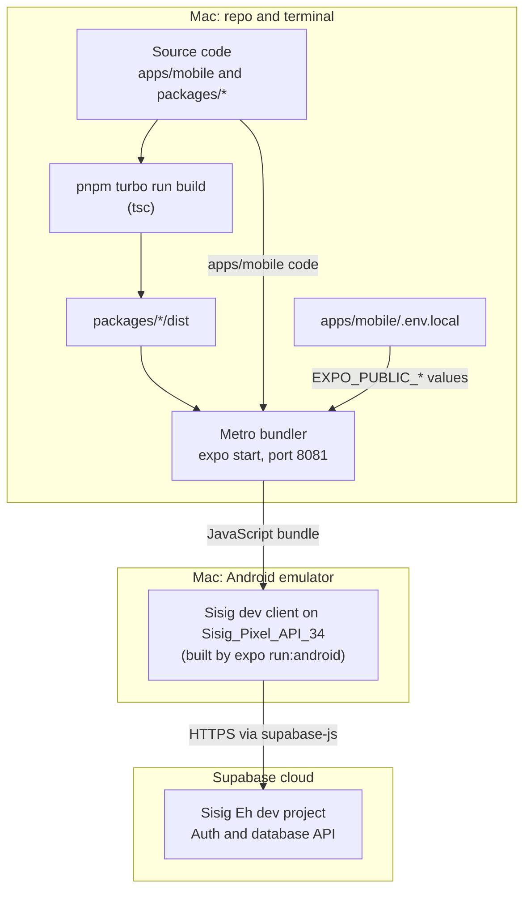
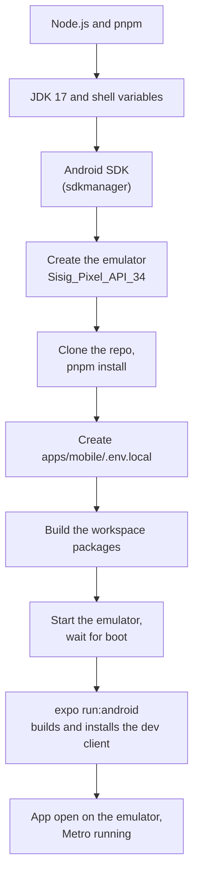

# Local Development

This guide takes a Mac from a clean clone to the Sisig Eh! mobile app running on an Android emulator, connected to the hosted Supabase dev project. It covers first-time setup, the daily routine, and fixes for failures the team has hit.

The steps were verified on 2026-11-06 on macOS 14 (Apple Silicon).

**Scope:**

- **Android only.** iOS needs the full Xcode app, which is not set up on the team's Mac yet. The Xcode Command Line Tools are not enough.
- **Expo Go is not supported.** The app runs in its own development build (the "dev client"), described below.
- **No local database.** The app talks to the hosted Supabase dev project. A local Supabase stack needs Docker; see [docs/SUPABASE.md](./SUPABASE.md) and [supabase/README.md](../supabase/README.md) for database work.

## What Runs Where



Metro bundles the app's JavaScript and serves it to the dev client on the emulator; both run on your Mac. The workspace packages reach Metro only through their compiled `dist/` folders, so they must be built first. The app then talks straight to the hosted Supabase project over the internet.

Terms used in this guide:

- **Dev client:** a debug build of this app with the native code it needs, plus the `expo-dev-client` launcher. You build it once and reinstall it only when native code changes.
- **Metro:** the JavaScript bundler that `expo start` runs. It serves the app's code on port 8081 and reloads the app when you save a file.
- **Workspace packages:** `@sisig/api`, `@sisig/ui` and `@sisig/claude` in `packages/`. Each `package.json` points `main` and `exports` at `dist/index.js`, so Metro cannot resolve them until `tsc` has built `dist/`.
- **AVD:** Android Virtual Device, the emulator's saved device profile.

## Prerequisites

| Tool | Version | Notes |
|---|---|---|
| macOS | 14, Apple Silicon | The setup below uses arm64 images. |
| Node.js | 18 or later | CI uses Node 18. The team's Mac runs Node 22. |
| pnpm | 9 | The root `package.json` sets `"packageManager": "pnpm@9.0.0"`. |
| JDK | 17 | Gradle needs it for the Android build. Any JDK 17 works. |
| Android SDK | API 34 | Installed with the command-line tools (or with Android Studio). |
| Git | any | |
| Supabase access | | Ask the project owner to add you to the "Sisig Eh" project in the Supabase dashboard. You need it to copy the API URL and the publishable key. |

**Disk space.** Measured on the team's Mac: the API 34 system image is about 4.2 GB, the AVD about 4.3 GB, the NDK about 3.0 GB, and `~/.gradle` about 4.6 GB. A build also writes several GB to `apps/mobile/android/app/build`. Plan for roughly 20 GB free. Builds failed on that Mac when the disk ran low (see [Troubleshooting](#troubleshooting)).

## First-Time Setup



The first nine boxes are the numbered steps below; the last box is the result. Steps 1 to 4 happen once per Mac, steps 5 to 7 and 9 once per clone, and step 8 (starting the emulator) every session.

### 1. Install Node.js and pnpm

Install Node.js 18 or later (for example from nodejs.org), then pnpm 9:

```bash
npm install -g pnpm@9
```

Check both:

```bash
node --version
pnpm --version
```

### 2. Install JDK 17 and set the shell variables

On the team's Mac, Homebrew's `openjdk@17` asked for the full Xcode app, so the Eclipse Temurin 17 tarball was used instead.

1. Download the Eclipse Temurin 17 JDK for macOS aarch64 as a `.tar.gz` from adoptium.net.
2. Extract it into your user Java folder. The file name depends on the version you downloaded:

   ```bash
   mkdir -p ~/Library/Java/JavaVirtualMachines
   ```

   ```bash
   tar -xzf ~/Downloads/OpenJDK17U-jdk_aarch64_mac_hotspot_<version>.tar.gz -C ~/Library/Java/JavaVirtualMachines
   ```

   This creates a folder such as `jdk-17.0.21+9`.
3. Add these lines to `~/.zshrc`, then open a new terminal:

   ```bash
   export JAVA_HOME="$(/usr/libexec/java_home -v 17)"
   export ANDROID_HOME="$HOME/Library/Android/sdk"
   export PATH="$JAVA_HOME/bin:$ANDROID_HOME/cmdline-tools/latest/bin:$ANDROID_HOME/platform-tools:$ANDROID_HOME/emulator:$PATH"
   ```

   `/usr/libexec/java_home -v 17` finds JDK 17 in `~/Library/Java/JavaVirtualMachines` as well as `/Library/Java/JavaVirtualMachines`. On the team's Mac it returns `~/Library/Java/JavaVirtualMachines/jdk-17.0.21+9/Contents/Home`.
4. Check that Java 17 is active:

   ```bash
   java -version
   ```

If you prefer not to edit `~/.zshrc`, put the variables in front of each command instead, for example `JAVA_HOME=... ANDROID_HOME=... pnpm -F @sisig/mobile exec expo run:android`. The rest of this guide assumes the variables are set.

### 3. Install the Android SDK

The team installed the SDK with the command-line tools' `sdkmanager`. Android Studio's SDK Manager installs the same packages into the same folder, if you prefer it.

1. Download "Command line tools only" for Mac from developer.android.com/studio.
2. Unzip it so that `sdkmanager` ends up in `$ANDROID_HOME/cmdline-tools/latest/bin`:

   ```bash
   mkdir -p "$ANDROID_HOME/cmdline-tools"
   ```

   ```bash
   unzip ~/Downloads/commandlinetools-mac-<version>_latest.zip -d "$ANDROID_HOME/cmdline-tools"
   ```

   ```bash
   mv "$ANDROID_HOME/cmdline-tools/cmdline-tools" "$ANDROID_HOME/cmdline-tools/latest"
   ```

3. Install the SDK packages:

   ```bash
   sdkmanager "platform-tools" "emulator" "platforms;android-34" "build-tools;34.0.0" "system-images;android-34;google_apis;arm64-v8a"
   ```

4. Accept the licences:

   ```bash
   yes | sdkmanager --licenses
   ```

   This can exit with code 141 (SIGPIPE) when your shell uses `set -o pipefail`. That is harmless: the licences are accepted.

The first Gradle build downloads the NDK and CMake by itself (on the team's Mac: NDK 26.1.10909125 and CMake 3.22.1). You do not install them here.

### 4. Create the emulator

Create an AVD named `Sisig_Pixel_API_34` (Pixel 8 profile, API 34):

```bash
avdmanager create avd -n Sisig_Pixel_API_34 -k "system-images;android-34;google_apis;arm64-v8a" -d pixel_8
```

If it asks whether to create a custom hardware profile, press Return to accept the default (no).

### 5. Clone the repo and install dependencies

```bash
git clone https://github.com/Alexd2004/Sisig.git
cd Sisig
```

```bash
pnpm install
```

Run every later command from the repo root.

### 6. Create `apps/mobile/.env.local`

The app reads two public values at bundle time. Create `apps/mobile/.env.local` with this content, then fill in the placeholders:

```text
EXPO_PUBLIC_SUPABASE_URL=https://<project-ref>.supabase.co
EXPO_PUBLIC_SUPABASE_ANON_KEY=<publishable key>
```

- `<project-ref>` is the ID of the "Sisig Eh" project. It is the last part of the project's dashboard URL (`supabase.com/dashboard/project/<project-ref>`).
- `<publishable key>` is on the dashboard under **Project Settings → API Keys**.

Rules:

- `.env.local` is git-ignored (`.gitignore` lists `.env.local`). Never commit it, and never paste its values into docs, issues or PRs.
- Use only the publishable key. Never put a secret key or a service-role key in the app: Expo copies every `EXPO_PUBLIC_*` value into the JavaScript bundle, where anyone with the app can read it. CI also fails if client code contains a service-role key (see [DEVOPS-02-CI.md](./DEVOPS-02-CI.md)).
- If either value is missing, the app throws at launch: `EXPO_PUBLIC_SUPABASE_URL and EXPO_PUBLIC_SUPABASE_ANON_KEY must be set. See CONTRIBUTING.md.` The check is in `apps/mobile/src/lib/supabase.ts`.

### 7. Build the workspace packages

```bash
pnpm turbo run build --filter='@sisig/mobile^...'
```

The filter `@sisig/mobile^...` means "every workspace package the mobile app depends on, but not the app itself". Each package compiles with `tsc` into its `dist/` folder. Without this step Metro cannot resolve `@sisig/ui` and the bundle fails.

Do not run plain `pnpm build` for this. It also runs the mobile app's `build` script (`expo build`), which the local Expo CLI rejects.

### 8. Start the emulator and wait for it to boot

Start the emulator in its own terminal tab. It keeps running there:

```bash
"$ANDROID_HOME/emulator/emulator" -avd Sisig_Pixel_API_34
```

In your main terminal, wait until Android has finished booting:

```bash
adb wait-for-device; until adb shell getprop sys.boot_completed | grep -q 1; do sleep 3; done
```

Until boot completes, `adb devices` lists the emulator as `offline`, and a build or launch started then fails.

### 9. Build and install the dev client

```bash
pnpm -F @sisig/mobile exec expo run:android
```

The first run takes a while. It:

1. Runs `expo prebuild` for Android, because `apps/mobile/android/` does not exist yet. Prebuild generates that native project and adds `"android"` and `"ios"` scripts to `apps/mobile/package.json`.
2. Builds the debug app with Gradle (the first build downloads Gradle, the NDK and CMake).
3. Installs the dev client on the emulator, starts Metro on port 8081 and opens the app.

**Do not commit the generated files.** Prebuild output is not in `.gitignore` yet: `git status` shows `apps/mobile/android/` (and `apps/mobile/ios/`, if you ever ran `expo run:ios` or a plain `expo prebuild`) as untracked, and `apps/mobile/package.json` as modified. Leave them out of your commits: stage files by name instead of `git add -A`, and undo the script change with `git restore apps/mobile/package.json` when you need a clean tree.

When the app opens on the emulator, setup is done.

## Daily Routine

1. Start the emulator in its own terminal tab, and wait for boot:

   ```bash
   "$ANDROID_HOME/emulator/emulator" -avd Sisig_Pixel_API_34
   ```

   ```bash
   adb wait-for-device; until adb shell getprop sys.boot_completed | grep -q 1; do sleep 3; done
   ```

2. If you pulled new commits, install dependencies and rebuild the packages:

   ```bash
   pnpm install
   ```

   ```bash
   pnpm turbo run build --filter='@sisig/mobile^...'
   ```

   Turborepo caches the build, so packages that did not change are restored from cache in a moment.

3. Start Metro and open the installed dev client:

   ```bash
   pnpm -F @sisig/mobile exec expo start --dev-client --android
   ```

   If dependencies changed in step 2, add `--clear` to this command (see [Troubleshooting](#troubleshooting)).

4. Edit code. Metro reloads the app when you save a file under `apps/mobile`. Press `r` in the Metro terminal to reload by hand.

5. After you change code in `packages/*`, run the build command from step 2 again. Metro reads the packages from `dist/`, so it does not see a source change until the package is rebuilt.

**When to rebuild the dev client.** Only when native code changes: a dependency with native code is added, removed or upgraded, or `apps/mobile/app.json` changes (plugins, icons, package name). `expo run:android` runs prebuild only when `apps/mobile/android/` does not exist, so after an `app.json` change delete that generated folder first:

```bash
rm -rf apps/mobile/android
```

```bash
pnpm -F @sisig/mobile exec expo run:android
```

JavaScript-only changes never need a rebuild.

**About `pnpm dev`.** The root `pnpm dev` also starts Metro. It runs Turborepo, which runs the mobile app's `dev` script, `expo start --dev-client`. Turborepo runs the `build` tasks of the workspace packages before it (the `^build` dependency in `turbo.json`). The root scripts also pass the deprecated `--parallel` flag; in a timing check with Turborepo 2.11.10 and no cache, dependent tasks still started only after the builds finished. Ordering under `--parallel` is not guaranteed by Turborepo's docs, so building the packages yourself first (step 2) is the safe routine. It does not pass `--android`, so it does not open the app on the emulator. The direct command in step 3 is the routine verified on the team's Mac.

## Database Work

The app uses the hosted Supabase dev project "Sisig Eh". It is the only hosted project. Schema changes go through migrations in pull requests (see [CONTRIBUTING.md](../CONTRIBUTING.md#database-changes)).

The Supabase CLI (2.122.0) is a root devDependency, so run it through `pnpm exec`. To connect your clone to the hosted project:

```bash
pnpm exec supabase login
```

```bash
pnpm exec supabase link --project-ref <project-ref>
```

`supabase link` stores the link in `supabase/.temp/`, which is git-ignored.

The local stack (`pnpm db:start`, `pnpm db:test`, `pnpm db:types`) needs Docker. Docker is not installed on the team's Mac, so the database tests run in CI. The full procedure for migrations, `supabase db push`, and destructive changes is in [docs/SUPABASE.md](./SUPABASE.md).

## Troubleshooting

### Metro: "Unable to resolve" `@sisig/ui` or another `@sisig/*` package

The workspace packages are not built, so their `dist/` folders are missing. Build them, then restart Metro:

```bash
pnpm turbo run build --filter='@sisig/mobile^...'
```

### Metro: "Unable to resolve <package>" after pulling

New JavaScript dependencies arrived. Install them, rebuild the packages, and restart Metro with a clear cache:

```bash
pnpm install
```

```bash
pnpm turbo run build --filter='@sisig/mobile^...'
```

```bash
pnpm -F @sisig/mobile exec expo start --dev-client --android --clear
```

### The app shows old code

Press `r` in the Metro terminal. If that does not help, force-stop the app and open it again from the emulator's launcher:

```bash
adb shell am force-stop com.sisig.mobile
```

`com.sisig.mobile` is the Android package name from `apps/mobile/app.json`.

### The app crashes at launch: "EXPO_PUBLIC_SUPABASE_URL and EXPO_PUBLIC_SUPABASE_ANON_KEY must be set. See CONTRIBUTING.md."

`apps/mobile/.env.local` is missing or incomplete (see [step 6](#6-create-appsmobileenvlocal)). After you fix it, restart Metro with `--clear` so the new values are bundled.

### The app crashes at launch: "Property 'jest' doesn't exist"

A test file is inside `apps/mobile/app/`. Expo Router turns every file in that folder into a route, so the test was bundled as a screen. Move the test out of `app/`, for example to `apps/mobile/src/`, and import the screen from there. `apps/mobile/src/navigation/index-redirect.test.tsx` is an example (PR #18).

### `adb devices` shows the emulator as "offline"

The emulator is still booting. Wait with the boot loop from [step 8](#8-start-the-emulator-and-wait-for-it-to-boot) before you build or launch.

### `adb`, `emulator`, `sdkmanager` or `avdmanager`: command not found

The PATH line from [step 2](#2-install-jdk-17-and-set-the-shell-variables) is missing or your terminal predates it. Open a new terminal, then check:

```bash
echo "$ANDROID_HOME"
```

### Gradle fails because Java is missing or is not version 17

`java -version` must report 17, and `JAVA_HOME` must point at that JDK. `/usr/bin/java` on macOS is only a stub that looks for an installed JDK; it does not provide one.

### `yes | sdkmanager --licenses` exits with code 141

Harmless. `yes` gets SIGPIPE when `sdkmanager` stops reading, and `set -o pipefail` reports that exit code. The licences are accepted.

### Homebrew `openjdk@17` asks for Xcode

Use the Temurin 17 tarball from [step 2](#2-install-jdk-17-and-set-the-shell-variables) instead. Any JDK 17 works.

### The build fails with disk errors, or the Mac runs out of space

An Android build needs several GB on top of the SDK and the AVD (see [Prerequisites](#prerequisites)). To free space, stop the Gradle daemon and delete the build output:

```bash
(cd apps/mobile/android && ./gradlew --stop)
```

```bash
rm -rf apps/mobile/android/app/build
```

The next build recreates the folder and takes longer.

### `expo-doctor` reports native project folders

After prebuild, `pnpm -F @sisig/mobile run doctor` also warns that `app.json` properties will not sync because `android/` and `ios/` exist. That warning comes from the generated folders on your machine. A clean clone has three other known failures, listed in the [README](../README.md#known-issues).

### iOS

Not set up. `pnpm -F @sisig/mobile exec expo run:ios` needs the full Xcode app and an iOS simulator, which the team's Mac does not have yet.
