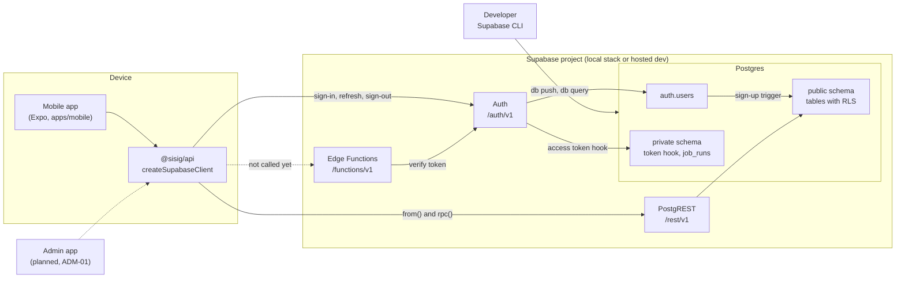
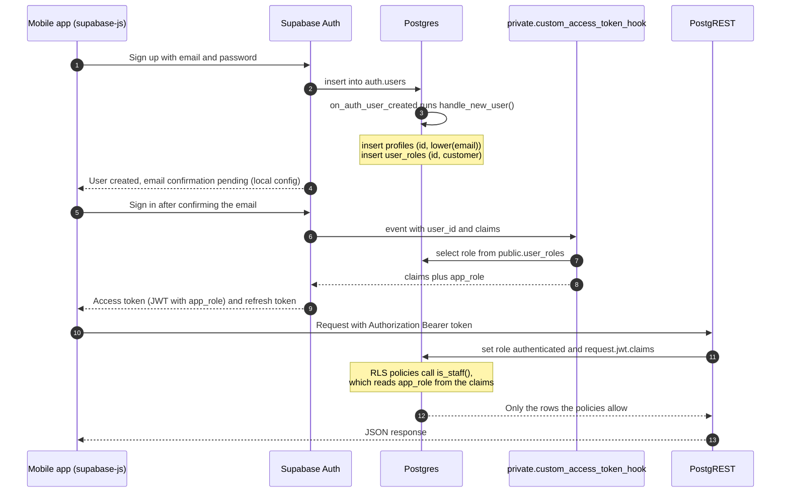
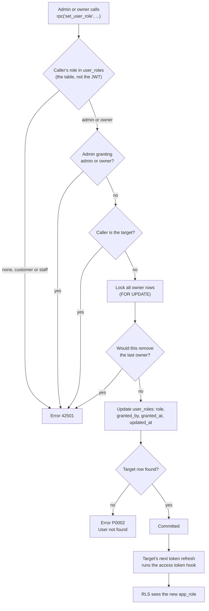
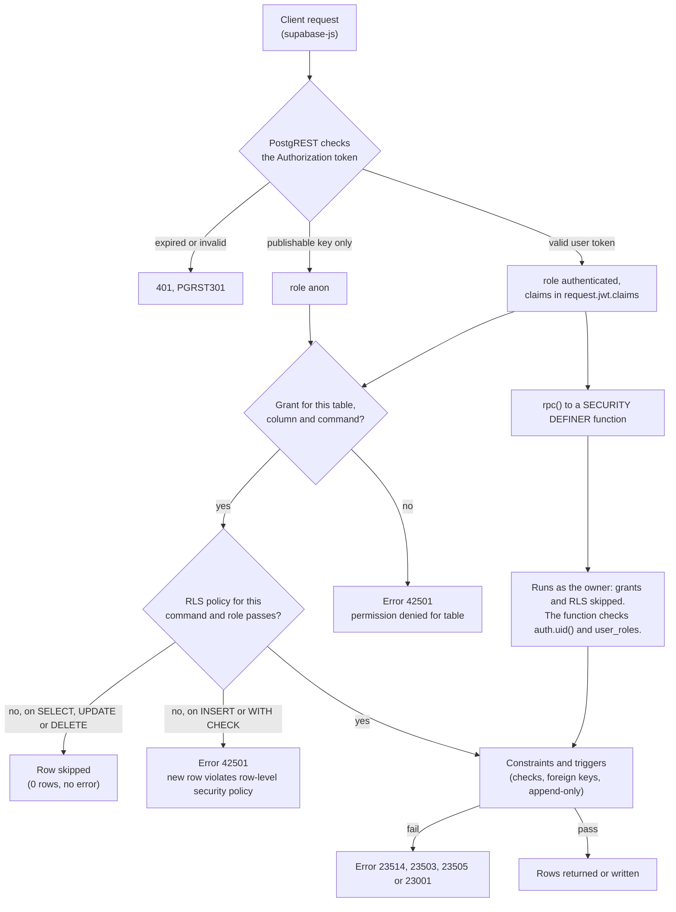
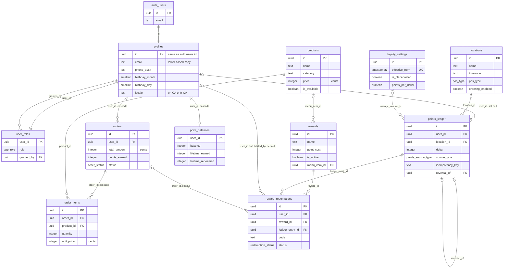
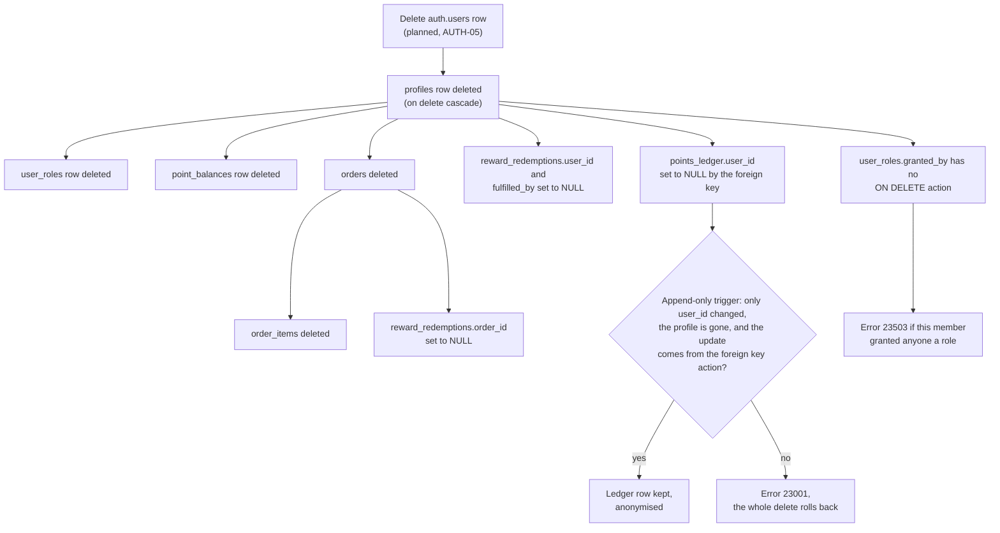
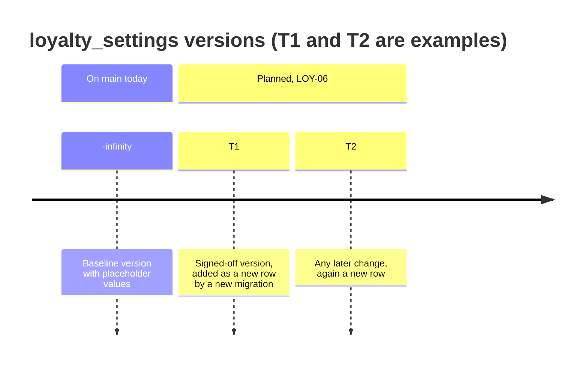
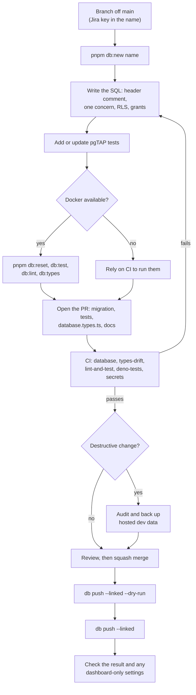

# Supabase in Sisig

This guide explains how Supabase works in the Sisig Eh! rewards app: auth and roles,
row-level security, the schema, the loyalty data model, how migrations reach the hosted
dev project, generated types, Edge Functions and tests. It describes `main` after PR #19
(DATA-04). Work that is planned but not built is marked with its Jira key, for example
"planned, LOY-01".

Related documents:

- [supabase/README.md](../supabase/README.md): commands and quick reference for the
  `supabase/` folder.
- [supabase/CONVENTIONS.md](../supabase/CONVENTIONS.md): the rules every migration,
  policy, function and test must follow.
- [LOCAL-DEVELOPMENT.md](LOCAL-DEVELOPMENT.md): running the app on an Android emulator and
  connecting it to the hosted dev project.
- [ARCHITECTURE.md](ARCHITECTURE.md): app architecture.
- [DEVOPS-02-CI.md](DEVOPS-02-CI.md): the CI jobs.

Why this file exists: PRs are squash merged. The squash commit keeps the PR title and the
commit messages, but not the PR description. Any rule or audit query that lived only in a
PR description is gone from `main`, so it belongs here or in the migration itself.

## Contents

- [What Supabase does for Sisig](#what-supabase-does-for-sisig)
- [Environments](#environments)
- [Identity and roles](#identity-and-roles)
- [Row-level security](#row-level-security)
- [Schema reference](#schema-reference)
- [Loyalty data model](#loyalty-data-model)
- [Rules for the LOY tickets](#rules-for-the-loy-tickets)
- [Migration lifecycle](#migration-lifecycle)
- [Working with the hosted dev project](#working-with-the-hosted-dev-project)
- [Generated types](#generated-types)
- [Edge Functions](#edge-functions)
- [Testing](#testing)
- [Troubleshooting](#troubleshooting)
- [Known issues](#known-issues)

## What Supabase does for Sisig

Supabase is a hosted Postgres database with services around it. Sisig uses these parts:

| Part | What Sisig uses it for | State on `main` |
| --- | --- | --- |
| **Auth** (Supabase's auth server, at `/auth/v1`) | Accounts, sessions, and access tokens (JWTs, signed JSON tokens) that carry an `app_role` claim | The app restores the session, refreshes tokens while in the foreground and purges the device on sign-out. The sign-in and sign-up screens are placeholders (planned, AUTH-01 to AUTH-03). |
| **Postgres** | Tables, constraints, triggers, functions and row-level security (RLS: per-row access rules enforced by the database) | 11 tables in `public`, one in `private`. Extensions `uuid-ossp`, `pg_cron`, `pgtap`, `pgcrypto` and `pg_net` are enabled. No `pg_cron` job exists yet. |
| **PostgREST** (at `/rest/v1`) | Turns the `public` schema into a REST API. supabase-js `from('table')` and `rpc('function')` call it. | `@sisig/api` has `useMenu`, `useProduct`, `useMenuCategories` (products) and `useCreateOrder` (orders). No screen calls them yet. |
| **Edge Functions** (Deno, at `/functions/v1`) | Server-side code that needs a trusted runtime | One sample function, `whoami`. Not deployed anywhere. |
| **Realtime, Storage, GraphQL** | Nothing yet | Enabled by `supabase/config.toml` but unused. No storage bucket exists. CI starts the stack without Realtime. |
| **Studio and the dashboard** | Browsing data and settings | Local Studio at `http://127.0.0.1:54323`; the Supabase dashboard for the hosted project. |

All client access goes through `createSupabaseClient` in `packages/api/src/client.ts`. The
mobile app creates its single client in `apps/mobile/src/lib/supabase.ts` with the public
URL and publishable key, and stores the session in encrypted storage.



The app talks to Supabase only through supabase-js. Auth writes `auth.users`, a trigger
creates the member's rows in `public`, and the token hook in `private` adds the role
claim. Dotted lines are not in use yet.

## Environments

There are two environments today: the local stack on a developer machine and one hosted
dev project. Staging and production do not exist yet (planned, DEVOPS-01).

| | Local stack | Hosted dev project |
| --- | --- | --- |
| What it is | Docker containers run by the Supabase CLI | Supabase cloud project "Sisig Eh", ref `dczjqhqpxbkikidtbntf`, Free plan, region us-east-1, created 2026-11-06 |
| Start or reach it | `pnpm db:start` (needs Docker) | Link once with `pnpm exec supabase link`, then use `--linked` commands |
| API URL (Auth, REST, Functions) | `http://127.0.0.1:54321` | `https://dczjqhqpxbkikidtbntf.supabase.co` |
| Database | `127.0.0.1:54322`, Postgres 15 (`[db] major_version = 15`) | Postgres 17, reached with `db push --linked` and `db query --linked` |
| Dashboard | Studio, `http://127.0.0.1:54323` | Supabase dashboard |
| Auth emails | Mailpit (a local mail catcher), `http://127.0.0.1:54324` | The project's Auth email settings in the dashboard |
| How the schema arrives | `pnpm db:start` on a new database, or `pnpm db:reset`, applies every migration | `pnpm exec supabase db push --linked` after a merge |
| Seed data (`supabase/seed.sql`) | Applied after the migrations | Loaded once. Later changes to `seed.sql` are not applied (see [Seed data](#seed-data-on-hosted-dev)). |
| Access token hook | Enabled by `[auth.hook.custom_access_token]` in `config.toml` | Must be enabled in the dashboard. Not confirmed yet. |
| Email confirmation before sign-in | Required (`enable_confirmations = true`) | Dashboard setting, not checked |
| Data | Disposable | Shared. Treat it as a shared environment: migrations applied there are never edited. |

`config.toml` sets no ports, so the local stack uses the CLI defaults shown above. The CI
`database` job prints the same ports.

History of the hosted dev project (observed on 2026-11-06):

1. It was first loaded from `main` with `supabase db push --include-seed`: the migrations up
   to `20261104180530` and the `seed.sql` of that time (the seven menu products).
2. The ten migrations from PR #19 were applied with `supabase db push --linked`, after a
   check that the legacy `users`, `loyalty_points` and `loyalty_transactions` tables held
   0 rows.
3. The placeholder store row was inserted by hand with `supabase db query --linked`.

### How the app chooses an environment

The mobile app reads two values from `apps/mobile/.env.local`. The file is gitignored. Never
commit it.

```bash
# apps/mobile/.env.local
EXPO_PUBLIC_SUPABASE_URL=https://<ref>.supabase.co
EXPO_PUBLIC_SUPABASE_ANON_KEY=<the project's publishable key, sb_publishable_...>
```

- For hosted dev, use the project URL and the publishable key from the dashboard.
- For the local stack, use `http://127.0.0.1:54321` and the publishable key that
  `pnpm db:start` or `pnpm exec supabase status` prints. An Android emulator cannot reach
  the host's `127.0.0.1`; see [LOCAL-DEVELOPMENT.md](LOCAL-DEVELOPMENT.md).
- Only the publishable (anon) key goes here. The secret or service-role key must never reach
  the app. CI's `secrets` job runs gitleaks over the whole repo, then greps `apps/` and
  `packages/` for one fixed string, the HS256 JWT header (the legacy key format), and for
  the name `SUPABASE_SERVICE_ROLE_KEY`. The grep has no rule for `sb_secret_` keys, so do
  not rely on it to catch one.
- `apps/mobile/src/lib/supabase.ts` throws at launch if either value is missing.
- Expo inlines `EXPO_PUBLIC_*` values when it bundles the app, so restart the dev server
  after you change the file.

## Identity and roles

### Where identity lives

| Object | Owner | Contents |
| --- | --- | --- |
| `auth.users` | Supabase Auth | Credentials, email, confirmation state |
| `public.profiles` | Sisig | One row per user, same `id` as `auth.users`. Name, E.164 phone, birthday (month and day, no year), province, locale (`en-CA` or `fr-CA`), and `email`, a lower-cased copy of the auth email. |
| `public.user_roles` | Sisig | One row per user: `role`, `granted_by`, `granted_at`, `updated_at`. Kept apart from profiles so a role change never touches profile data. |

### Sign-up creates the profile and role

The trigger `on_auth_user_created` runs `public.handle_new_user()` after every insert into
`auth.users`. The function is `SECURITY DEFINER` (it runs as its owner, not as the caller)
and:

1. inserts `profiles (id, email)` with the email lower-cased;
2. inserts `user_roles (user_id, role)` with role `customer`.

Both inserts use `on conflict do nothing`. If the email is null, the profile insert fails
(`23502`) and the whole sign-up fails, so no `auth.users` row is left behind. Sign-up
metadata such as a first name is not copied into `profiles`.

The trigger `on_auth_email_changed` runs `public.sync_profile_email()` when
`auth.users.email` changes, and copies the new address, lower-cased, into `profiles.email`.

### Roles and the helper functions

The enum `public.app_role` has four labels. Each role includes the access of the ones
before it.

| Role | What it adds | `is_staff()` | `is_admin()` | `is_owner()` |
| --- | --- | --- | --- | --- |
| `customer` | Default for every sign-up. Own rows only. | false | false | false |
| `staff` | Reads every row that has a staff policy; inserts and updates products | true | false | false |
| `admin` | Can set `customer` or `staff` with `set_user_role` | true | true | false |
| `owner` | Can grant any role, including `admin` and `owner` | true | true | true |
| (no token, or no claim) | Anonymous request | false | false | false |

`public.is_staff()`, `public.is_admin()` and `public.is_owner()` read the `app_role`
claim from the request's JWT (`auth.jwt() ->> 'app_role'`). They do not read
`user_roles`. They return `false`, never NULL, when the claim is missing.

### The access token hook adds `app_role`

`private.custom_access_token_hook(event jsonb)` runs each time Auth issues or refreshes an
access token. It reads the user's role from `public.user_roles` and adds it as `app_role`
inside the event's `claims` object. A user without a `user_roles` row gets
`app_role: null`.

- `supabase_auth_admin` (the role Auth uses) has `USAGE` on `private` and may execute it.
  `anon` and `authenticated` cannot call it.
- It is `SECURITY DEFINER`, so it reads `user_roles` as its owner and RLS does not filter
  the read.
- `config.toml` registers it for the local stack only. `db push` does not configure Auth.
  On each hosted project, enable it in the dashboard: **Authentication → Hooks → Customize
  Access Token → `private.custom_access_token_hook`**.
- Without the hook, nobody gets an `app_role` claim, so every staff, admin and owner is
  treated as a customer by RLS. Whether the hook is enabled on hosted dev has not been
  confirmed. Check it before you test anything that needs staff access.



Sign-up runs the trigger once. Every sign-in and every token refresh runs the hook again,
so a role change reaches the token at the next refresh. The app screens for steps 1 and 5
are planned (AUTH-01 to AUTH-03); the database side exists today.

### Changing a role: `set_user_role`

Clients cannot write `user_roles`: `anon` has no privileges on it, `authenticated` has no
INSERT, UPDATE, DELETE or TRUNCATE privilege, and the table has no write policy. The only
client path is the RPC `public.set_user_role(p_user_id uuid, p_role app_role)`. It is
`SECURITY DEFINER`. `authenticated` may execute it; `anon` may not.

It checks the caller's role in the `user_roles` table, not in the JWT, so a demoted admin is
refused at once, even while their token still says `admin`. The checks run in this order:

| Check | Result when it fails |
| --- | --- |
| The caller has a `user_roles` row | `42501` "Caller has no role" |
| The caller is `admin` or `owner` | `42501` "Permission denied: insufficient role" |
| An admin is not granting `admin` or `owner` | `42501` "Admin cannot grant admin or owner role" |
| The caller is not changing their own role | `42501` "Cannot change your own role" |
| (locks every owner row with `FOR UPDATE`, so two demotions cannot run at once) | |
| The change does not remove the last owner | `42501` "Cannot demote the last remaining owner" |
| The target has a `user_roles` row | `P0002` "User not found" |

On success it sets `role`, `granted_by` (the caller), `granted_at` and `updated_at`.

What this means in practice:

- An **owner** can give any role, including `owner`, to anyone else, and can demote another
  owner while at least two owners exist.
- An **admin** can set `customer` or `staff` on anyone else. The function does not stop an
  admin from demoting another admin, or an owner who is not the last owner.
- **Staff** and **customers** cannot change roles.



`set_user_role` takes effect in the table at once. RLS policies see it only when the
target's token is refreshed, up to one token lifetime later. `config.toml` does not set
`jwt_expiry`, so the local stack uses the CLI default of one hour.

### The first owner

`set_user_role` needs an existing admin or owner, and no migration creates one. Set the
first owner once per environment with SQL run as the database owner. This is also how the
tests set up roles.

```bash
pnpm exec supabase db query --linked \
  "update public.user_roles set role = 'owner' where user_id = (select id from public.profiles where email = '<email>') returning user_id, role"
```

For the local stack, use `--local` instead of `--linked`. The user then signs out and back
in, so their next token carries `app_role: owner`. After that, use `set_user_role` for every
other change.

## Row-level security

### Principles

1. **Every `public` table has RLS enabled.** A table with RLS and no matching policy returns
   no rows and accepts no writes.
2. **Two gates.** Postgres checks table and column privileges (grants) first, then RLS
   policies. A request must pass both.
3. **Supabase grants a lot by default.** New `public` tables get full privileges for `anon`,
   `authenticated` and `service_role`. Migrations revoke what they do not want.
4. **Staff checks read the JWT.** Policies call `is_staff()`, which is fast and avoids
   policy recursion, but can be stale for one token lifetime. Writes that need a privilege
   re-check `user_roles` inside a `SECURITY DEFINER` function, as `set_user_role` does.
5. **Tables added by DATA-04 and DATA-18 are read-only for every API role.** No API role
   can write `locations`, `loyalty_settings`, `points_ledger`, `point_balances`, `rewards`
   or `reward_redemptions`. `authenticated` and `service_role` hold SELECT on all six.
   `anon` holds SELECT on `locations`, `loyalty_settings` and `rewards` only, and nothing
   on the other three. Writes are meant to go through `SECURITY DEFINER` RPCs (planned,
   LOY-01/03/04).
6. **`service_role` skips RLS but not grants.** It is the role behind the secret
   (service-role) key. It keeps default privileges on the older tables (`profiles`,
   `user_roles`, `products`, `orders`, `order_items`), so it can write them directly. On
   the six tables above it can only read.
7. **Roles:** `anon` is a request with only the publishable key. `authenticated` is a
   request with a signed-in user's token. Both reach Postgres through PostgREST.



A request passes the grant check, then RLS, then constraints and triggers. A
`SECURITY DEFINER` function skips the first two gates, so it must check the caller itself.

### Policy patterns in use

| Pattern | Example | Used on |
| --- | --- | --- |
| Own rows | `(select auth.uid()) = user_id`; older policies use `auth.uid() = id` | `profiles`, `user_roles`, `orders`, `points_ledger`, `point_balances`, `reward_redemptions` |
| Staff read everything | `(select public.is_staff())`; `profiles` and `user_roles` use `public.is_staff()` | All tables except `order_items`, `locations` and `loyalty_settings` |
| Public read | `to anon, authenticated using (true)` | `locations`, `loyalty_settings` |
| Public read with a filter | `is_available = true`; active, not archived and inside the date window | `products`, `rewards` |
| Through the parent row | `exists (select 1 from public.orders where id = order_items.order_id and user_id = auth.uid())` | `order_items` |
| Own insert | `with check (auth.uid() = user_id)` | `orders` |
| No write policy | Writes only through a `SECURITY DEFINER` function | `user_roles` and the six DATA-04/DATA-18 tables |

Wrapping a function in `(select ...)` makes Postgres evaluate it once per statement instead
of once per row. The newer policies do this.

### Who can read and write each table

"Member" means a signed-in user acting on their own rows, whatever their role. "Staff" means
`is_staff()` is true: staff, admin or owner, according to the token.

| Table | anon reads | Member reads | Staff reads | Client writes allowed today | Intended write path |
| --- | --- | --- | --- | --- | --- |
| `profiles` | nothing | own row | all | UPDATE of own row, only `first_name`, `last_name`, `phone_e164`, `birthday_month`, `birthday_day`, `province`, `locale` | Sign-up trigger creates the row; email trigger keeps `email` in sync; `birthday_locked_at` is server-owned (no writer yet) |
| `user_roles` | nothing (no grants) | own row | all | none | `set_user_role` RPC; sign-up trigger inserts `customer` |
| `products` | available rows | available rows | all | staff INSERT and UPDATE; no DELETE policy | Staff through PostgREST |
| `orders` | nothing | own orders | all | member INSERT of own order, with any `status`, `total_amount` and `points_earned` (only non-negative checks apply); no UPDATE or DELETE policy | Not settled (planned, DATA-06) |
| `order_items` | nothing | items of own orders | items of own orders only (no staff policy) | none: no INSERT policy | Not settled (planned, DATA-06) |
| `locations` | all | all | all | none (SELECT only) | Migrations; admin RPCs later |
| `loyalty_settings` | all | all | all | none (SELECT only) | A new migration per version (planned, LOY-06) |
| `points_ledger` | nothing (no grants) | own entries | all | none (SELECT only) | `SECURITY DEFINER` RPCs (planned, LOY-01/03/04) |
| `point_balances` | nothing (no grants) | own row | all | none (SELECT only) | Same RPCs, in the same transaction as the ledger insert |
| `rewards` | live rewards | live rewards | all | none (SELECT only) | Migrations or admin RPCs (planned, ADM work) |
| `reward_redemptions` | nothing (no grants) | own redemptions | all | none (SELECT only) | Redemption RPC (planned, LOY-03) |

### Functions in `public` and `private`

| Function | Runs as | Who may execute | Purpose |
| --- | --- | --- | --- |
| `public.is_staff()`, `is_admin()`, `is_owner()` | definer | any role (execute not revoked) | Read the `app_role` claim |
| `public.set_user_role(p_user_id, p_role)` | definer | `authenticated` (not `anon`) | Change a role (rules above) |
| `public.current_loyalty_settings(p_at)` | invoker (the caller) | `anon`, `authenticated`, `service_role` | Loyalty rules in effect at a time |
| `public.handle_new_user()`, `public.sync_profile_email()` | definer | triggers on `auth.users` | Sign-up and email sync |
| `private.custom_access_token_hook(event)` | definer | `supabase_auth_admin` | Add `app_role` to tokens |
| `private.enforce_points_ledger_append_only()` | invoker | trigger on `points_ledger` | Block updates and deletes |

Every function sets `search_path = ''` and schema-qualifies what it touches. The generated
types list the five functions clients can call: the three helpers, `set_user_role` and
`current_loyalty_settings`.

## Schema reference



The current `public` schema and its link to `auth.users`. Labels name the foreign key
column and its delete action. `private.job_runs` has no foreign keys and is not shown.

### Tables

| Table | Purpose | Notable rules | Added by |
| --- | --- | --- | --- |
| `profiles` | Member details | E.164 phone check; birthday month and day both set or both null, and the day must exist in the month (29 February allowed); unique lower-cased email | DATA-02 |
| `user_roles` | One role per member | Default `customer`; clients write it only through the sign-up trigger and `set_user_role` (`service_role` keeps default write privileges) | DATA-02 |
| `products` | Menu items | `price` in cents, `price >= 0` | DATA-01 |
| `orders` | Customer orders | `user_id` references `profiles` (on delete cascade); `total_amount >= 0`, `points_earned >= 0` | DATA-01, DATA-04 |
| `order_items` | Order lines | `quantity > 0`, `unit_price >= 0`, deleted with the order | DATA-01 |
| `locations` | Stores | E.164 phone; `timezone` defaults to `America/Edmonton`; `hours` as JSON in the store's time zone; ordering off by default | DATA-18 (slim) |
| `loyalty_settings` | Versioned programme rules | Unique `effective_from`; one `-infinity` placeholder baseline | DATA-04 |
| `points_ledger` | Every change to a member's points | Append-only; see below | DATA-04 |
| `point_balances` | One chain-wide balance per member | All three counters `>= 0`; no location column | DATA-04 |
| `rewards` | Reward catalogue | `point_cost > 0`; visible to everyone only while active, not archived and inside `starts_at`/`ends_at` | DATA-04 |
| `reward_redemptions` | Issued reward codes | Code unique among issued redemptions; `points_spent > 0` | DATA-04 |
| `private.job_runs` | Log for scheduled jobs | Status `running`, `success` or `error`; no job writes it yet | DATA-01 |

The money and points checks on `products`, `orders` and `order_items` were added
`NOT VALID`: Postgres checks new and updated rows, but not rows that existed before.
A later migration will validate them (see [Audit queries](#audit-queries-for-the-open-not-valid-checks)).

No table has a trigger that maintains `updated_at`. Only `set_user_role` sets it, on
`user_roles`.

### Enums

| Enum | Labels |
| --- | --- |
| `app_role` | `customer`, `staff`, `admin`, `owner` |
| `order_status` | `pending`, `confirmed`, `preparing`, `ready`, `completed`, `cancelled` |
| `pos_type` | `square`, `toast` |
| `loyalty_rounding_mode` | `down`, `nearest`, `up` |
| `loyalty_earn_base` | `pre_tax_subtotal`, `post_tax_total` |
| `loyalty_expiry_policy` | `none`, `inactivity` |
| `points_source_type` | `pos_purchase`, `qr_counter`, `receipt`, `admin_adjust`, `reward_redeem`, `redemption_refund`, `offer_bonus`, `expiry`, `reversal`, `signup_bonus` |
| `redemption_status` | `issued`, `fulfilled`, `cancelled`, `expired` |
| `redemption_channel` | `counter`, `pickup` |

### Removed objects

PR #19 dropped the legacy `public.users` table, the `public.user_role` enum, and the
`public.loyalty_points` and `public.loyalty_transactions` tables. The loyalty tables were
dropped by product-owner decision, without migrating their rows. The `users` rows were not
migrated either; roles are granted again with `set_user_role`. The old migrations stay in
`supabase/migrations/` as history.

## Loyalty data model

DATA-04 added the loyalty tables, constraints, indexes, read policies and grants. It added
no posting, redemption or reversal logic. That logic is planned for LOY-01, LOY-03 and
LOY-04, as `SECURITY DEFINER` RPCs. Until then, `useRedeemPoints` in
`packages/api/src/mutations.ts` throws on purpose.

### `points_ledger`: append-only

Each change to a member's points is one row. Rows are never updated or deleted. A mistake
is fixed by adding a new row.

| Column | Meaning |
| --- | --- |
| `user_id` | The member. Becomes NULL when the member is deleted. |
| `location_id` | Store where the points were earned. Required for in-store sources. |
| `delta` | Points added (positive) or removed (negative). Never 0; between -1,000,000 and 1,000,000. |
| `source_type`, `source_id` | What caused the entry, and the id of that record (POS transaction, receipt, offer). |
| `idempotency_key` | Unique per `source_type`. Stops the same event being posted twice. |
| `reversal_of` | For `reversal` rows only: the entry being reversed. |
| `reason`, `metadata` | Free text and JSON. No personal data. |
| `settings_version_id` | The `loyalty_settings` version used. |
| `created_by` | Staff or admin actor, set only for their actions. No foreign key, so the row outlives the actor. |

Sources fall into two groups:

- **In-store**, `location_id` required: `pos_purchase`, `qr_counter`, `receipt`.
- **Chain-level**, `location_id` optional: `signup_bonus`, `offer_bonus`, `expiry`,
  `admin_adjust`, `reward_redeem`, `redemption_refund`, `reversal`.

The index on `(user_id, created_at desc, id desc)` serves member history, newest first,
with a stable order for keyset pagination (paging by the last row seen).

The trigger `points_ledger_append_only` runs `private.enforce_points_ledger_append_only()`
before every UPDATE or DELETE and raises `23001` ("points_ledger is append-only: UPDATE is
not allowed"), whoever runs the statement, the table owner `postgres` included. The API
roles hold at most SELECT (`authenticated` and `service_role` hold SELECT, `anon` nothing),
so they fail earlier with `42501`.
TRUNCATE is revoked from the API roles because it skips row triggers. The table owner can
still truncate.

### Idempotency keys and reversals

- `unique (source_type, idempotency_key)` on `points_ledger`: a second insert with the same
  key and source type fails with `23505`. The same key string under another source type is
  allowed.
- `unique (user_id, idempotency_key)` on `reward_redemptions`: a retried redemption request
  cannot issue twice.
- A `reversal` row must set `reversal_of`, and only a `reversal` row may set it.
- `unique (reversal_of)`: an entry can be reversed at most once.
- The database does not check that a reversal's `delta` cancels the original, or that each
  source type has the right sign. Those rules belong to the RPCs (planned, LOY-01/03/04).

### Member deletion and anonymisation

Deleting a member (planned, AUTH-05) deletes the `auth.users` row. Nothing in the app does
this yet; the tests do it directly. The foreign keys then decide what happens to each table.



A member's balance, role and orders are deleted. Their ledger entries and redemptions are
kept with `user_id` set to NULL. The `granted_by` branch is a known gap that AUTH-05 must
handle.

The trigger lets an update through only when all of these hold:

1. it is an UPDATE that changes `user_id` from a value to NULL;
2. every other column is unchanged;
3. the profile `user_id` pointed at no longer exists;
4. it runs inside a trigger (`pg_trigger_depth() > 1`), as a foreign key action does.

A direct `update ... set user_id = null` fails, and so does a trigger that clears `user_id`
while the profile still exists.

Anonymisation clears only `user_id`. Any member identifier stored elsewhere in the row
(email, phone, user id inside a key) would survive. That is why the column comments on
`source_id`, `idempotency_key`, `reason` and `metadata` forbid personal data.

### `point_balances`

One row per member, chain-wide: points earned at one store can be spent at another.
`balance`, `lifetime_earned` and `lifetime_redeemed` are all `>= 0`. The LOY RPCs will
maintain the row from the ledger; no trigger does. No row is created at sign-up, so a member
has no balance row until an RPC writes one.

### `rewards`

A reward costs `point_cost` points (`> 0`). Everyone sees a reward while `is_active` is true,
`archived_at` is null and now is inside the optional `starts_at`/`ends_at` window. Staff see
every reward. `is_active` defaults to false. `stock` and `per_user_limit` are stored but not
enforced; the redemption RPC will enforce them (planned, LOY-03). `menu_item_id` optionally
links the reward to the product it gives away.

### `reward_redemptions`: one-time codes

A redemption is issued with a short `code` that staff look up at the counter or at pickup.
It spends points through exactly one ledger entry (`ledger_entry_id`, required).

- `status` is `issued`, `fulfilled`, `cancelled` or `expired`. The database adds no state
  rules; LOY-03 will.
- A partial unique index makes `code` unique among `issued` rows only. Once a redemption is
  fulfilled, cancelled or expired, its code can be issued again. A separate index serves
  code lookups.
- `expires_at` is required. Nothing moves an expired code to `expired` automatically.
- `channel` is `counter` or `pickup`. `order_id` links a pickup redemption to its order.
- `order_id` and `fulfilled_by` are indexed because every member deletion follows them.

### `loyalty_settings` and `current_loyalty_settings(at)`

Each row is one version of the programme rules. A version is in effect from its
`effective_from` (inclusive) until the next version starts. A new version is added by a new
migration; rows are not edited. Nothing in the database blocks an edit by the table owner,
so this is a convention.

The baseline row starts at `-infinity`, so every timestamp has a version. Its values are
placeholders until the client signs off the rules (planned, LOY-06). `is_placeholder` is
true and the label starts with `PLACEHOLDER`. The migration inserts it, so it exists on
every environment, hosted dev included.

| Setting | Baseline (placeholder) value |
| --- | --- |
| `points_per_dollar`, `rounding_mode`, `earn_base` | 1, `down`, `pre_tax_subtotal` |
| `min_spend_cents` | 0 |
| `daily_points_cap` | 200 |
| `max_points_per_transaction`, `daily_receipt_claims_cap` | none |
| `purchase_age_limit_days` | 14 |
| `signup_bonus_points` | 25 |
| `expiry_policy`, `inactivity_months`, `expiry_warning_days` | `none`, none, empty |
| `redemption_code_ttl_minutes` | 15 |
| `multipliers` | `{}` |

`public.current_loyalty_settings(p_at timestamptz default now())` returns the version with
the latest `effective_from` at or before `p_at`. The unique `effective_from` and the
baseline mean exactly one row comes back for every non-null time. The function is `STRICT`,
so a NULL argument returns NULL. It runs as the caller, and `anon`, `authenticated` and
`service_role` may call it.



`current_loyalty_settings(at)` returns the baseline for any `at` before T1, the T1 version
for T1 up to (not including) T2, and the T2 version from T2 on.

PostgREST sends the baseline's `effective_from` as the string `"-infinity"`. The generated
type is `string`, and `new Date("-infinity")` is an invalid date. Clients must handle that
value explicitly.

### The placeholder location

DATA-18 was done "slim": Sisig has one store, so there is one `locations` row.

- Locally, `supabase/seed.sql` inserts `PLACEHOLDER Sisig Edmonton` (id
  `10ca7100-0000-4000-8000-000000000001`, Edmonton coordinates, `America/Edmonton`, empty
  hours, ordering off). The seed comment says not to add a second store.
- On hosted dev the same row was inserted by hand, because the seed is not re-run there.
- Real store data comes from the client.
- Deferred until a second store exists: per-location staff RLS (DATA-18 AC4) and
  per-location settings with a chain fallback (DATA-18 AC5). `location_id` on orders and
  receipts belongs to DATA-06 and DATA-07.

## Rules for the LOY tickets

These rules apply to LOY-01 (earning), LOY-03 (redemption), LOY-04 (reversals and
adjustments), DATA-06 (orders) and any other work that writes loyalty data.

1. **Write only through `SECURITY DEFINER` RPCs** added in migrations. No API role has a
   write grant on `locations`, `loyalty_settings`, `points_ledger`, `point_balances`,
   `rewards` or `reward_redemptions`: `authenticated` and `service_role` hold SELECT only,
   and `anon` holds SELECT on `locations`, `loyalty_settings` and `rewards` and nothing on
   the rest. Do not add write grants or write policies so that a client or an
   Edge Function can write these tables directly. Follow the function rules in
   [CONVENTIONS.md](../supabase/CONVENTIONS.md#security-definer-functions).
2. **Re-check roles in `user_roles`** for staff and admin actions. The `app_role` claim can
   be one token lifetime out of date. Set `created_by` only for staff and admin actions.
3. **Keep member identifiers out of identifier columns.** `points_ledger.source_id`,
   `points_ledger.idempotency_key`, `points_ledger.reason`, `points_ledger.metadata` and
   `reward_redemptions.idempotency_key` must not contain a user id, email, phone or any
   other member identifier. Anonymisation clears only `user_id`, so anything else in the
   row outlives the member.
4. **Never trust client-written order fields.** Members can insert `orders` rows directly
   today (the "Users can create orders" policy), with any `status`, `total_amount` and
   `points_earned` the client sends; only the non-negative checks apply. LOY-01 and DATA-06
   must never compute points from, or award points because of, client-written
   `orders.status`, `orders.total_amount` or `orders.points_earned`.
5. **Skip zero-point postings.** `delta <> 0` rejects them. An earn that rounds to 0 points
   must not insert a row.
6. **Write the ledger row and the balance in one function call**, so they commit together.
   The `balance >= 0` check rejects a spend that would make the balance negative.
7. **Use the settings in effect at the time of the event.** Call
   `current_loyalty_settings(<event time>)` rather than relying on `now()`, and store the
   version's id in `settings_version_id`. The baseline is a placeholder until LOY-06.
8. **Handle `"-infinity"`.** The baseline `effective_from` reaches JavaScript as the string
   `"-infinity"`, which `Date` cannot parse.
9. **Reverse once, and negate correctly.** The database allows one reversal per entry but
   does not check its sign or size.
10. **Check `expires_at` on every code lookup.** Nothing expires codes automatically, and an
    `issued` row keeps its code reserved until its status changes.
11. **Do not hard-code the placeholder store's id.** Real stores will be new rows.
12. **Add pgTAP tests for each RPC** that call it as `anon`, as a member and as staff, and
    check both the success path and each rejection.

## Migration lifecycle



A migration goes from a branch through CI and a squash merge, then someone pushes it to
the hosted dev project by hand. Nothing deploys migrations automatically.

### Steps

1. Create a branch off `main`, named as [CONTRIBUTING.md](../CONTRIBUTING.md) describes.
2. Run `pnpm db:new <snake_case_name>`. It creates
   `supabase/migrations/<timestamp>_<name>.sql`. Never pick a timestamp by hand.
3. Write the SQL. Start with a header comment: the Jira key, the one concern, why, any data
   impact, and "Forward-only: no existing migration is edited." Follow
   [CONVENTIONS.md](../supabase/CONVENTIONS.md).
4. Add or update pgTAP tests in `supabase/tests/database/`, and update each `plan(n)`.
5. If you have Docker, run `pnpm db:reset`, `pnpm db:test`, `pnpm db:lint` and
   `pnpm db:types`. Without Docker, push the branch and let CI run them.
6. Commit the migration, the tests, the regenerated `packages/api/src/database.types.ts`
   and doc updates (this guide, and the schema list in
   [supabase/README.md](../supabase/README.md)) in one PR.
7. Fill in the PR template's **Migration Impact** section. Put audit queries and data-loss
   notes in the migration header or in this guide as well, because the squash merge drops
   the PR description.
8. CI must pass: `database` (pgTAP tests and schema lint), `types-drift`, `lint-and-test`,
   `deno-tests` and `secrets`. See [DEVOPS-02-CI.md](DEVOPS-02-CI.md).
9. For a destructive change, follow the rules below before you merge.
10. Squash merge to `main`.
11. From an up-to-date `main`, push to hosted dev:
    [Apply migrations](#apply-migrations-after-a-merge).

### Destructive migrations

A migration is destructive when it can lose or reject existing data: dropping a table,
column or type, changing a column type, adding NOT NULL, adding a constraint or foreign key
that checks existing rows, or rewriting data.

1. **Audit hosted dev before you merge.** Run the queries that count the rows the
   migration would drop or reject, with `pnpm exec supabase db query --linked "<sql>"`.
   Record the result in the PR.
2. **Back up the affected data before you merge.** Export the rows to a file outside the
   repo. `pnpm exec supabase db dump --linked --data-only -f <file>` is one option. If it
   does not work on your machine, save the output of
   `pnpm exec supabase db query --linked "select * from public.<table>"`. The file holds
   personal data: keep it out of git and delete it when it is no longer needed.
3. **Put any backfill in the same PR, before the destructive migration.** After the merge
   there is no slot for it: migrations are forward-only, and `db push` stops when a local
   migration sorts before the last one applied on the remote (only `--include-all`
   overrides that, and it should not be used to rewrite history on a shared database).
4. **Fail loudly instead of deleting quietly.** For example,
   `20261106230040_retire_legacy_users.sql` adds a validated foreign key, so it fails with
   `23503` if an order has no profile, rather than deleting the order.
5. **Add checks that old rows might fail as `NOT VALID`**, and validate them in a later
   migration once the data is clean. `20261104180526_money_points_checks.sql` adds its
   checks this way; the validating migration does not exist yet.
6. **Get product-owner sign-off for data loss.** The legacy table drops in PR #19 record
   that decision in their migration headers.

### Audit queries for the open NOT VALID checks

`20261104180526_money_points_checks.sql` says to run "the audit queries in the PR
description" before applying it, and to validate the checks later. Those queries are not on
`main`. These queries count the rows each check would reject. Run them before the migration
that validates the checks (planned; no Jira key is recorded in the code):

```sql
select 'products.price' as rule, count(*) from public.products where price < 0
union all
select 'orders.total_amount', count(*) from public.orders where total_amount < 0
union all
select 'orders.points_earned', count(*) from public.orders where points_earned < 0
union all
select 'order_items.unit_price', count(*) from public.order_items where unit_price < 0;
```

Every count must be 0 before `alter table ... validate constraint ...` runs.

## Working with the hosted dev project

The Supabase CLI 2.122.0 is a root devDependency (locked in `pnpm-lock.yaml`), so run it as
`pnpm exec supabase ...`. CI installs the same version.

### One-time setup per machine

1. Install dependencies from the repo root:

   ```bash
   pnpm install
   ```

2. Sign the CLI in to your Supabase account. Your account needs access to the project.

   ```bash
   pnpm exec supabase login
   ```

3. Link the repo to the hosted dev project. The CLI stores the link in `supabase/.temp/`,
   which is gitignored.

   ```bash
   pnpm exec supabase link --project-ref dczjqhqpxbkikidtbntf
   ```

4. Check that the project is listed and linked:

   ```bash
   pnpm exec supabase projects list
   ```

While you are logged in, `db push` and `db query --linked` print "Initialising login
role..." and connect with a temporary role through the Supabase Management API. You do not
need the database password.

### Apply migrations after a merge

1. Update your local `main`, so the migration files match `main`.
2. List the pending migrations:

   ```bash
   pnpm exec supabase db push --linked --dry-run
   ```

3. Check that the list holds only the migrations you expect, in order.
4. Apply them:

   ```bash
   pnpm exec supabase db push --linked
   ```

5. Run the dry run again. It should list nothing.
6. If the change needs a dashboard-only setting (such as the access token hook), set it by
   hand.

`pnpm exec supabase migration list --linked` compares the local files with the migrations
recorded on the hosted project.

### Run SQL

```bash
pnpm exec supabase db query --linked "select count(*) from public.profiles"
```

The command prints the result rows as JSON. `-f <file.sql>` runs a file instead. The
temporary role can write tables that are read-only for the API roles (the placeholder store
was inserted this way), so grants and RLS do not protect you here. Run a SELECT first, and
make schema changes only through migrations.

### Seed data on hosted dev

`seed.sql` is local test data. On a push with `--include-seed`, the CLI records each seed
file's hash in `supabase_migrations.seed_files` and does not run a changed `seed.sql` again
on a later push. So:

- Do not run `db push --include-seed` on hosted dev again.
- Insert any row hosted dev needs by hand with `db query --linked`. For example, the
  placeholder store, copied from `seed.sql`:

  ```bash
  pnpm exec supabase db query --linked \
    "insert into public.locations (id, name, address, latitude, longitude, timezone, hours, ordering_enabled) values ('10ca7100-0000-4000-8000-000000000001', 'PLACEHOLDER Sisig Edmonton', 'PLACEHOLDER address, Edmonton, AB', 53.546100, -113.493800, 'America/Edmonton', '{}', false) on conflict do nothing"
  ```

### Check the access token hook

1. In the dashboard, open **Authentication → Hooks**.
2. Check that **Customize Access Token** is enabled and points to
   `private.custom_access_token_hook`.
3. To confirm it works, sign in as a test user and decode the payload of the access token
   (`session.access_token` from `supabase.auth.getSession()`). It must contain `app_role`.
   Until the sign-in screens exist (planned, AUTH-01 to AUTH-03), create test users in the
   dashboard.

### Connect the app

Set `apps/mobile/.env.local` as in [How the app chooses an environment](#how-the-app-chooses-an-environment).
[LOCAL-DEVELOPMENT.md](LOCAL-DEVELOPMENT.md) covers running the app against hosted dev.

### Do not

- Run `supabase db reset --linked`. It rebuilds the hosted database and deletes its data.
- Edit a migration that hosted dev has applied. Write a new one.
- Commit `supabase/.temp/`, `.env.local`, keys or backup files.

## Generated types

`packages/api/src/database.types.ts` holds TypeScript types for the `public` schema: tables
(Row, Insert, Update), enums and the RPCs. `createSupabaseClient` returns a
`SupabaseClient<Database>`, so `from()` and `rpc()` calls are type-checked.

```bash
pnpm db:start
pnpm db:types
```

`pnpm db:types` runs `supabase gen types typescript --local --schema public`. It writes to a
temporary file and replaces the committed file only if the output is not empty. If the
stack is not running, it exits 1 and leaves the committed file alone. `private` is not
typed, because clients cannot reach it.

The CI `types-drift` job starts a fresh stack from the migrations, runs `pnpm db:types`, and
fails if the file differs from the committed copy. It prints the diff. Without Docker, you
can apply that diff by hand. Commit the regenerated file in the same PR as the schema
change.

Do not edit or format the file. `pnpm format` runs `prettier --write src` in
`packages/api`, which would rewrite it and fail `types-drift`.

Things to know about the types:

- Timestamps are `string`. `loyalty_settings.effective_from` can be `"-infinity"`.
- Columns with a default are optional in `Insert`.
- `Functions` lists `is_staff`, `is_admin`, `is_owner`, `set_user_role` and
  `current_loyalty_settings`.

## Edge Functions

### What exists

| Path | What it is |
| --- | --- |
| `supabase/functions/whoami/` | Sample function. `GET` returns `{ user: { id, email, appRole } }`. `OPTIONS` returns 204. Other methods return 405. A missing or rejected token returns 401. |
| `supabase/functions/_shared/auth.ts` | `getBearerToken`, `authenticate`, `decodeJwtPayload`, `requireRole`, `authConfigFromEnv` |
| `supabase/functions/_shared/cors.ts` | CORS headers, preflight and JSON responses |
| `supabase/functions/_shared/errors.ts` | `AppError` and the error envelope `{ "error": { "code", "message" } }` |
| `supabase/functions/_shared/import_map.json` | An import map. `config.toml` does not reference it. |

Each function keeps `index.ts` to one `Deno.serve(...)` call and puts its logic in
`handler.ts`, so tests can import the handler without a server.

`authenticate` sends the caller's token to `GET <SUPABASE_URL>/auth/v1/user`, which rejects
expired, revoked or forged tokens. Only then does it read the `app_role` claim from the
token. An unknown or missing claim becomes `appRole: null`. `requireRole` returns 403 for a
role that is not allowed. `authConfigFromEnv` reads `SUPABASE_URL` and `SUPABASE_ANON_KEY`,
which Supabase sets for every function, and returns 500 "Server misconfigured" if either is
missing.

CORS allows any origin (`*`). `cors.ts` notes that it must be tightened before production.

### How functions are tested

The Deno tests (`_shared/auth_test.ts`, `_shared/errors_test.ts`,
`_shared/import_map_test.ts`, `whoami/handler_test.ts`) inject a fake `fetch`, so they need
no running stack. The `deno-tests` job in `.github/workflows/edge-functions.yml` runs on
every PR to `main`:

```bash
deno test --allow-all --no-config supabase/functions
deno fmt --check --no-config supabase/functions
deno lint --no-config supabase/functions
```

To call a function locally, start the stack and run
`pnpm exec supabase functions serve` (see [supabase/README.md](../supabase/README.md#edge-functions)).

### Deployment is not set up

No workflow deploys Edge Functions, and this guide has no record of a manual deploy to
hosted dev. The mobile app does not call any function.

## Testing

### pgTAP database tests

pgTAP is a unit-test framework for Postgres. The tests live in `supabase/tests/database/`
and run in file-name order.

| File | What it covers |
| --- | --- |
| `01_init.sql` | `public` and `private` schemas; `uuid-ossp`, `pg_cron` and `pgcrypto`; `job_runs`, `products`, `orders`, `order_items`; key columns |
| `02_identity.sql` | Structure of `profiles` and `user_roles`; `app_role` labels; policy names; the helpers and `set_user_role` exist; phone and birthday checks; defaults |
| `03_identity_behaviour.sql` | DATA-02 behaviour: sign-up creates one profile and one `customer` role; lower-cased email and email sync; sign-up without email fails; hook output and grants; stale JWT versus the `set_user_role` re-check; every role rule; direct writes to `user_roles` blocked by grants and by RLS; read isolation; helper truth table, including `anon`; phone and birthday rules |
| `04_set_user_role_lock.sql` | The `FOR UPDATE` owner lock comes before the last-owner count; a role change sets `updated_at` |
| `05_money_points_checks.sql` | Negative `price`, `total_amount`, `points_earned` and `unit_price` are rejected; the four checks exist and are `NOT VALID` |
| `06_legacy_schema_cleanup.sql` | Legacy tables and enum are gone; `orders.user_id` references `profiles`; staff policies are exactly `(select is_staff())`; staff versus customer reads; deleting a member deletes their orders |
| `07_locations.sql` | Columns, time zone default, `pos_type`, one read policy, one seeded `PLACEHOLDER` store, RLS on, SELECT-only for all three API roles |
| `08_loyalty_settings.sql` | One `-infinity` placeholder baseline; `current_loyalty_settings` at, before and after version boundaries; unique `effective_from`; SELECT-only grants; RLS and policy |
| `09_points_ledger_append_only.sql` | `postgres` cannot update or delete (23001); `service_role` cannot either (42501); privileges; nested-trigger updates rejected; deleting a member keeps the rows with `user_id` NULL and nothing else changed |
| `10_points_ledger_integrity.sql` | History index; idempotency per source type; one reversal per entry; `reversal_of` rule; location rule for in-store sources; chain-level sources; `delta` non-zero and bounded; member and staff reads |
| `11_balances_and_redemptions.sql` | Privileges on balances, redemptions and rewards; RLS on; code index; chain-wide balance; policy sets; member and staff reads; the public catalogue window; code unique among issued and reusable after; what a member deletion does to balances, orders and redemptions |

How the tests work:

- Each file runs as `postgres` inside one transaction and rolls back at the end.
- Fixtures insert into `auth.users`, so the real sign-up trigger creates profiles and roles.
- Files switch role with `set local role authenticated` (or `anon`) and fake the token with
  a `pg_temp.act_as(uid, app_role)` helper that sets `request.jwt.claims`. They call the
  hook function directly. They cannot show that the hook is enabled on a hosted project.
- Each file uses its own UUID prefix for fixtures (for example `09000000-...`; 03 and 04
  both use `00000000-...`) and avoids
  data that a later migration might add.

Run them with `pnpm db:test` (needs the local stack, so Docker). The CI `database` job runs
the same command after `supabase start`, which applies every migration and then `seed.sql`
(`07_locations.sql` reads the seeded store). Docker is not available on the team's main
Mac, so these tests have been verified in CI, not locally.

`pnpm db:lint` runs `supabase db lint` on `public` and `private` and fails on errors. CI runs
it in the `database` job.

## Troubleshooting

Local-stack problems (Docker, `db:reset`, stale types, function 500s) are in
[supabase/README.md](../supabase/README.md#troubleshooting).

| Symptom | Cause | Fix |
| --- | --- | --- |
| App throws at launch: "EXPO_PUBLIC_SUPABASE_URL and EXPO_PUBLIC_SUPABASE_ANON_KEY must be set" | `apps/mobile/.env.local` is missing or incomplete | Create it ([Environments](#how-the-app-chooses-an-environment)) and restart the dev server |
| A staff, admin or owner account sees only its own rows | No `app_role` claim: the hook is off on that project, or the token was issued before the role change | Check the hook ([steps](#check-the-access-token-hook)); sign out and back in |
| `permission denied for table ...` (42501) | The role has no grant for that command, for example any write to the DATA-04 tables, or `anon` reading `points_ledger` | Expected. Writes go through RPCs. |
| `new row violates row-level security policy for table ...` | No INSERT policy, or WITH CHECK failed (for example `order_items`) | Expected today; see [Known issues](#known-issues) |
| An UPDATE or DELETE returns no error but changes nothing | No policy for that command, so RLS hides every row | Expected; use the RPC for that change |
| `infinite recursion detected in policy for relation ...` | A policy reads its own table | Use a helper function ([CONVENTIONS.md](../supabase/CONVENTIONS.md)) |
| `points_ledger is append-only: UPDATE is not allowed` (23001) | Any update or delete on the ledger | Add a correcting or `reversal` row |
| `duplicate key value violates unique constraint "points_ledger_source_type_idempotency_key_key"` | The same event was posted twice | The first posting stands; treat the retry as done |
| `Invalid Date` from `loyalty_settings.effective_from` | The baseline is `"-infinity"` | Handle the value explicitly |
| A change to `seed.sql` never reaches hosted dev | The CLI records seed files by hash | Insert the rows with `db query --linked` |
| `db push` lists migrations you did not expect, or refuses one | Your `main` is behind, or a timestamp sorts before the last applied migration | Update `main`; rename a clashing migration ([README](../supabase/README.md#timestamp-clashes)) |
| `types-drift` fails | The committed types do not match the migrations | Run `pnpm db:types`, or apply the diff CI prints |
| `set_user_role` with an unknown user shows "A database error occurred" | It raises `P0002` "User not found", which `normalizeError` in `packages/api/src/client.ts` does not map (permission denials, `42501`, map to `PERMISSION_DENIED`) | Known issue; read `error.details` |

## Known issues

1. **The hook on hosted dev is unconfirmed.** Until someone checks the dashboard, assume
   staff access may not work there.
2. **Creating an order with items fails.** `useCreateOrder` in
   `packages/api/src/mutations.ts` inserts the order, then its items. `order_items` has no
   INSERT policy, so the second insert fails and the order row is left without items. No
   screen calls the hook yet. Orders belong to DATA-06 (planned).
3. **Orders trust the client.** Members can insert orders with any `status`,
   `total_amount` and `points_earned`. No role can update or delete orders through the API.
4. **Staff cannot read other members' order items.** `order_items` has no staff policy.
5. **Deleting a user who granted a role fails.** `user_roles.granted_by` references
   `profiles` with no ON DELETE action, so the delete fails with `23503`. AUTH-05 (planned)
   must handle it.
6. **Sign-up needs an email.** `profiles.email` is NOT NULL, so a sign-up without an email
   fails. Sign-up metadata is not copied into `profiles`.
7. **An admin can demote another admin, or an owner who is not the last.**
   `set_user_role` only stops admins from granting `admin` or `owner`. No test covers these
   cases.
8. **Money and points checks are `NOT VALID`.** Old rows are not checked until a validating
   migration runs.
9. **`updated_at` is not maintained.** No table has an `updated_at` trigger.
10. **Error mapping is out of date.** `normalizeError` still maps the old `PERM` and
    `NTFND` codes, which the database no longer raises, and does not map `P0002`.
11. **Postgres versions differ.** The local stack and CI run Postgres 15; hosted dev runs
    Postgres 17.
12. **Some `config.toml` keys are not CLI settings.** `[project]`, `[db] seed_file_path`,
    `[auth] email_autoconfirm` and `[auth] other_providers` do not appear in the template
    that `supabase init` writes for CLI 2.122.0. The seed still runs, from the CLI's default
    path. GitHub and Google sign-in are not configured (that needs `[auth.external.*]`
    blocks), and auth redirect URLs are not set (planned, AUTH-01).
13. **Redemption codes do not expire on their own.** No job moves `issued` rows to
    `expired`.
14. **Edge Functions are not deployed**, and their CORS setting allows any origin.
15. **The table owner can still truncate `points_ledger`**, which skips the append-only
    trigger. Only the API roles lost TRUNCATE.
16. **`pnpm db:reset` does not start the stack.** Run `pnpm db:start` first.
17. **`db:reset` timing is not measured.** The 3-minute target in
    [supabase/README.md](../supabase/README.md) has not been checked.
